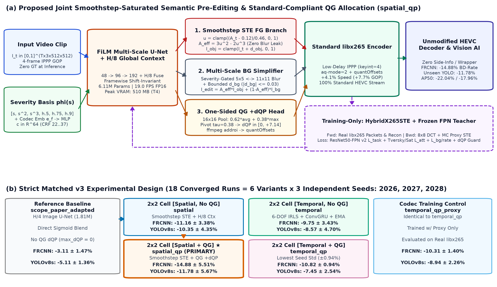
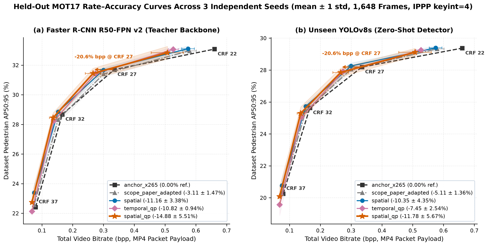
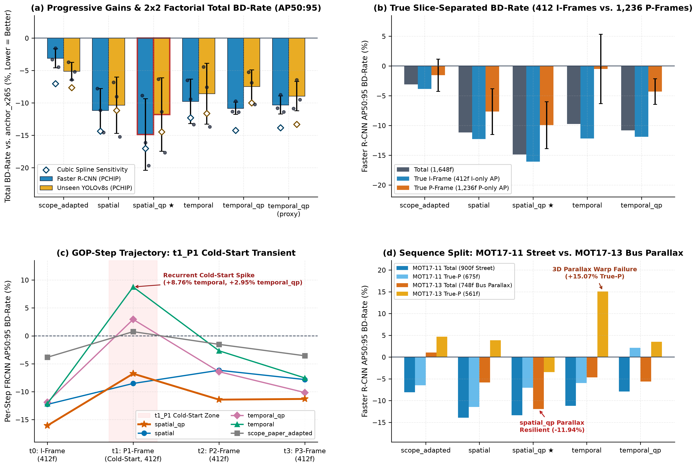
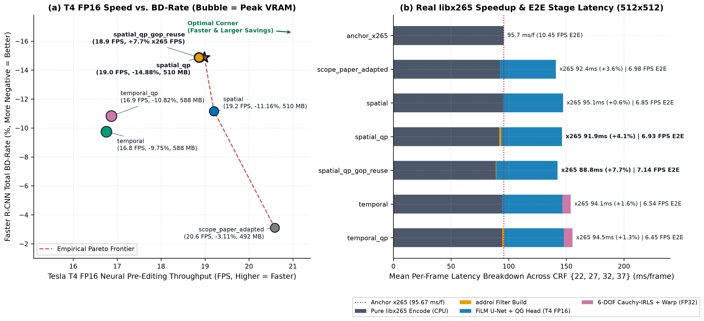
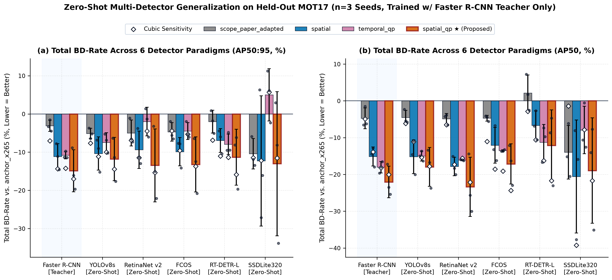

# T-SCOPE v3: Đồng Thiết kế Tiền xử lý Ngữ nghĩa Bão hòa Smoothstep & Phân bổ Lượng tử hóa QG Hợp chuẩn cho Nén Video Độ trễ Thấp Phục vụ Thị giác Máy

> **Kho Mã nguồn Chính thức**: [`https://github.com/munnn01/scope_by_me`](https://github.com/munnn01/scope_by_me) | **Phiên bản Giao thức**: `schema_version = 3` | **Mã nguồn Huấn luyện Khóa cứng (Pinned Training Revision)**: `92d778c356331f5fb3d8f9e66f7388b33821a1ad`  
> **Trạng thái Thực nghiệm**: Hoàn tất & xác minh mật mã học **18/18 lượt huấn luyện & đánh giá độc lập** (`6 biến thể × 3 seed {2026, 2027, 2028}`), **khái quát hóa Zero-Shot xuyên 6/6 họ kiến trúc detector** (`Faster R-CNN`, `YOLOv8s`, `RetinaNet v2`, `FCOS`, `RT-DETR-L`, `SSDLite320`), **1,648 khung hình kiểm định độc lập** (`MOT17-11` + `MOT17-13`), **đo đạc độ trễ/VRAM thực trên GPU NVIDIA Tesla T4** và kiểm toán phân tách lát cắt I/P thực.

---

## Mục lục

1. [Tổng quan & Phát hiện Khoa học Cốt lõi](#1-tổng-quan--phát-hiện-khoa-học-cốt-lõi)
2. [Định vị Học thuật & Đối sánh với 5 Công trình Tiên phong](#2-định-vị-học-thuật--đối-sánh-với-5-công-trình-tiên-phong)
3. [Mô hình Toán học & Kiến trúc Chi tiết](#3-mô-hình-toán-học--kiến-trúc-chi-tiết)
4. [Thiết kế Thực nghiệm Đối chứng Nghiêm ngặt (Matched v3 Protocol)](#4-thiết-kế-thực-nghiệm-đối-chứng-nghiêm-ngặt-matched-v3-protocol)
5. [Kết quả Thực nghiệm Đã Xác minh](#5-kết-quả-thực-nghiệm-đã-xác-minh)
   - [5.1. Bảng Tổng hợp BD-Rate Chính (`AP50:95` & `AP50`)](#51-bảng-tổng-hợp-bd-rate-chính-ap5095--ap50)
   - [5.2. Phân tích Độ nhạy Nội suy (PCHIP so với Cubic Spline)](#52-phân-tích-độ-nhạy-nội-suy-pchip-so-với-cubic-spline)
   - [5.3. Bảng Kết quả Chi tiết Từng Seed (`2026`, `2027`, `2028`)](#53-bảng-kết-quả-chi-tiết-từng-seed-2026-2027-2028)
   - [5.4. Đối sánh Cặp Tính lại Trực tiếp giữa các Nhánh](#54-đối-sánh-cặp-tính-lại-trực-tiếp-giữa-các-nhánh)
   - [5.5. Điểm Hoạt động Trung bình theo Từng mức `CRF ∈ {22, 27, 32, 37}`](#55-điểm-hoạt-động-trung-bình-theo-từng-mức-crf--22-27-32-37)
   - [5.6. Chẩn đoán Lát cắt Thực (`True-I` vs `True-P`), Bước GOP (`t0_I..t3_P3`) & Thị sai Camera](#56-chẩn-đoán-lát-cắt-thực-true-i-vs-true-p-bước-gop-t0_it3_p3--thị-sai-camera)
   - [5.7. Độ Phức tạp, Độ trễ Tesla T4, VRAM & Gia tốc Mã hóa `libx265` Thực](#57-độ-phức-tạp-độ-trễ-tesla-t4-vram--gia-tốc-mã-hóa-libx265-thực)
   - [5.8. Khái quát hóa Zero-Shot Đa Kiến trúc Detector](#58-khái-quát-hóa-zero-shot-đa-kiến-trúc-detector)
6. [Kiểm toán Mật mã học & Truy xuất Nguồn gốc (SHA-256 Registry)](#6-kiểm-toán-mật-mã-học--truy-xuất-nguồn-gốc-sha-256-registry)
7. [Cấu trúc Kho Mã nguồn & Hướng dẫn Tái lập Từng bước](#7-cấu-trúc-kho-mã-nguồn--hướng-dẫn-tái-lập-từng-bước)
8. [Giới hạn Phạm vi Bằng chứng & Hướng Phát triển](#8-giới-hạn-phạm-vi-bằng-chứng--hướng-phát-triển)
9. [Trích dẫn & Ghi công](#9-trích-dẫn--ghi-công)

---

## 1. Tổng quan & Phát hiện Khoa học Cốt lõi

Trong các hệ thống **Video Coding for Machines (VCM)** triển khai ngoài thực tế (camera giao thông thông minh, xe tự hành, giám sát đô thị), luồng video bắt buộc phải đi qua các bộ mã hóa tiêu chuẩn có độ trễ thấp như **HEVC/`libx265`** để tận dụng phần cứng giải mã sẵn có và cho phép con người kiểm tra trực quan khi cần. Tuy nhiên, các bộ mã hóa chuẩn tối ưu hóa độ trung thực toàn ảnh theo mắt người thay vì bảo toàn đặc trưng ngữ nghĩa cho mạng phát hiện đối tượng.

Kho mã nguồn này trình bày **T-SCOPE v3**, một khung nghiên cứu thực nghiệm đối chứng chặt chẽ cho bài toán nén video độ trễ thấp (`IPPP`, `keyint=4`, `aq-mode=2`) phục vụ phát hiện người đi bộ, với **phương pháp đề xuất chính là `spatial_qp`** (*Joint Smoothstep-Saturated Semantic Pre-Editing & Standard-Compliant QG `quantOffsets` Allocation*) đặt trong một thiết kế nhân tố $2\times 2$ hoàn chỉnh (`spatial`, `spatial_qp`, `temporal`, `temporal_qp`) cùng hai nhánh đối chứng độc lập (`temporal_qp_proxy`, `scope_paper_adapted`).



*Hình 1: Tổng quan kiến trúc hệ thống **T-SCOPE v3 (`spatial_qp`)** theo chuẩn biểu diễn Video Coding for Machines (tệp nguồn vector có thể chỉnh sửa trực tiếp trên `draw.io`: [`docs/figures/fig_pipeline_architecture.drawio`](docs/figures/fig_pipeline_architecture.drawio); bản in vector PDF: [`docs/figures/fig_pipeline_architecture.pdf`](docs/figures/fig_pipeline_architecture.pdf)).*

### Năm kết quả khoa học cốt lõi đã được kiểm chứng

1. **Bước tiến rõ rệt và nhất quán của phương pháp chính `spatial_qp` (100% tương thích chuẩn HEVC, 0 bit phụ trợ)**:
   - Xuất phát từ tham chiếu tiền xử lý ảnh chuyển thể sang giao thức dự án `scope_paper_adapted` (**`-3.11 ± 1.47%`** Faster R-CNN `AP50:95` / **`-5.11 ± 1.36%`** YOLOv8s `AP50:95`), việc nâng cấp lên kiến trúc tiền xử lý không gian có nhánh ngữ cảnh $H/8$, bão hòa tiền cảnh **Smoothstep STE** và làm mờ nền đa tỷ lệ phụ thuộc mức nén (`spatial`) đưa mức tiết kiệm BD-rate lên **`-11.16 ± 3.38%`** (FRCNN) và **`-10.35 ± 4.35%`** (YOLOv8s).
   - Khi đồng thiết kế thêm cơ chế phân bổ lượng tử hóa một phía **`+ΔQP` cấp nhóm lượng tử hóa (QG $16\times 16$)** truyền trực tiếp vào `x265_picture.quantOffsets` qua `ffmpeg addroi`, phương pháp đề xuất chính **`spatial_qp`** đạt hiệu quả trung bình tốt nhất trên toàn bộ kho thí nghiệm:
     - **Giáo viên Faster R-CNN R50-FPN v2**: **`-14.88 ± 5.51%`** (`AP50:95`, PCHIP) / **`-17.01 ± 5.40%`** (Cubic) và **`-22.04 ± 4.28%`** (`AP50`).
     - **Kiểm định Zero-Shot trên YOLOv8s (100% không tham gia huấn luyện)**: **`-11.78 ± 5.67%`** (`AP50:95`, PCHIP) / **`-14.46 ± 5.31%`** (Cubic) và **`-17.96 ± 5.28%`** (`AP50`).
     - Đối sánh cặp tính lại trực tiếp trên từng seed xác nhận `spatial_qp` vượt `scope_paper_adapted` **`-12.09 ± 5.68%`** (FRCNN) / **`-7.12 ± 5.46%`** (YOLOv8s), và vượt `spatial` thuần pixel **`-3.84 ± 2.46%`** (FRCNN) / **`-1.47 ± 1.75%`** (YOLOv8s).

2. **Đứng `#1` tuyệt đối về BD-rate tổng (`AP50:95`) xuyên suốt `6/6` họ kiến trúc Detector với 0% huấn luyện lại ([`results/cross_detector_bdbr.json`](results/cross_detector_bdbr.json))**:
   - Dù quá trình huấn luyện chỉ sử dụng duy nhất giáo viên hai giai đoạn **Faster R-CNN R50-FPN v2**, luồng video HEVC chuẩn của `spatial_qp` đạt mức tiết kiệm BD-rate trung bình tốt nhất trên **cả 6/6 kiến trúc kiểm định** (khớp bit-exact `60/60` đường cong `diff_bytes = 0`): **Faster R-CNN** (`-14.88%`), **RetinaNet R50-FPN v2** (`-13.46%` `AP50:95` / **`-23.37%`** `AP50`), **FCOS R50-FPN** (`-13.23%` / `-17.14%`), **SSDLite320 MobileNetV3-Large** (`-13.02%` / `-18.96%`), **YOLOv8s** (`-11.78%` / `-17.96%`), và mạng Vision-Transformer **RT-DETR-L** (`-11.33%` PCHIP / **`-15.87%`** Cubic).
   - Cơ chế phân bổ **QG `+ΔQP`** (`spatial` $\to$ `spatial_qp`) tiếp tục cắt giảm thêm tốc độ bit trên mọi detector độ phân giải đầy đủ (`-3.84%` FRCNN, `-4.02%` RetinaNet v2, `-3.94%` RT-DETR-L, `-3.26%` FCOS, `-1.47%` YOLOv8s), trong khi chuyển sang `temporal_qp` làm phình bit trên cả 6/6 họ mạng (`+4.35%` đến `+22.63%`).

3. **Giải mã thực nghiệm tại sao tiền xử lý bất biến dịch chuyển + QG (`spatial_qp`) vượt hồi quy bù chuyển động 6-DOF (`temporal_qp`) trong HEVC độ trễ thấp GOP ngắn**:
   - Phép thử nhân tố $2\times 2$ cho thấy thêm gói thời gian (ước lượng chuyển động toàn cục 6-DOF Cauchy-IRLS + `TemporalConvGRUCell` + làm trơn nền EMA + hàm phạt thời gian) **không cải thiện BD-rate trung bình** trong cấu hình `IPPP keyint=4`: chuyển từ `spatial_qp` $\to$ `temporal_qp` làm tăng bitrate **`+5.45 ± 7.13%`** (FRCNN) và **`+5.29 ± 4.10%`** (YOLOv8s), mặc dù `temporal_qp` giúp thu hẹp phương sai giữa các seed xuống mức rất thấp (**`±0.94%`** trên FRCNN).
   - Kiểm toán phân tách lát cắt trên `412` I-frame và `1,236` P-frame thực ([`results/v3_slice_and_sequence_diagnostics.json`](results/v3_slice_and_sequence_diagnostics.json)) chỉ ra hai nguyên nhân vật lý gốc rễ:
     1. **Quá độ khởi động lạnh ở khung `t1_P1` (`t1_P1` Cold-Start Transient)**: Ngay tại khung P đầu tiên sau I-frame — nơi trạng thái ẩn ConvGRU vừa chuyển từ $\mathbf{h} _ 0 = \mathbf{0}$ sang $\mathbf{h} _ 1 \neq \mathbf{0}$ — `temporal` chịu phạt **`+8.76%`** và `temporal_qp` chịu phạt **`+2.95%`** BD-rate, trước khi kịp hồi phục ở `t2_P2` (`-6.42%`) và `t3_P3` (`-10.15%`). Trong GOP dài 4, `P1` chiếm 1/3 tổng số P-frame. Ngược lại, `spatial_qp` duy trì BD-rate âm ở **mọi bước GOP** (`-16.08%`, `-6.77%`, `-11.42%`, `-11.30%`).
     2. **Sụp đổ mô hình phẳng Affine 6-DOF dưới thị sai 3D mạnh (`MOT17-13` Bus Parallax)**: Trên camera xe buýt chạy nhanh `MOT17-13`, thị sai chiều sâu giữa tiền cảnh gần và nền xa làm phép warp 6-DOF toàn cục gây lệch cấu trúc liên khung (`temporal` True-P bị phạt **`+15.07%`** FRCNN / **`+12.63%`** YOLO), trong khi `spatial_qp` giữ vững mức tiết kiệm **`-11.94%`** (FRCNN) và **`-11.08%`** (YOLO) nhờ để bộ ước lượng chuyển động phân cấp nội tại của `libx265` xử lý chuyển động cục bộ trên nền đã làm sạch và gán trọng số `+ΔQP`.

4. **Ưu thế Pareto trên phần cứng GPU Tesla T4 & Phát hiện gia tốc mã hóa `libx265` thực**:
   - Trên NVIDIA Tesla T4 ([`results/t4_complexity_runtime.json`](results/t4_complexity_runtime.json)), `spatial_qp` tăng tốc **`1.82×`** khi bật FP16 Tensor Cores (`95.84` $\to$ **`52.67 ms/khung`**, **`18.99 FPS`**, đỉnh VRAM chỉ **`509.8 MB`**), nhanh hơn `+12.6%` và tiết kiệm `-13.4%` VRAM so với `temporal_qp` (`59.29 ms/khung`, `16.87 FPS`, `588.4 MB` do nút cổ chai giải hệ tuyến tính Cauchy-IRLS phải chạy ở FP32 ngoài `autocast` mất `6.66 ms/khung`).
   - Đặc biệt, làm phẳng nền kết hợp đẩy cao `+ΔQP` vùng nền giúp **tăng tốc chính bộ mã hóa CPU `libx265` thực**: `spatial_qp` mã hóa nhanh hơn **`+4.14%` FPS** (`91.87` so với `95.67 ms/khung`, `10.89` so với `10.45 FPS`, tương ứng ~`+4.2%` khi tính trên FPS làm tròn) trong khi cắt giảm `-22.0%` tốc độ bit trung bình (`0.2392` so với `0.3068 bpp`) nhờ kích hoạt sớm chế độ CU SKIP / khối hệ số DCT bằng không và giảm tải mã hóa entropy CABAC. Khi bật chế độ tái sử dụng bản đồ QG đầu GOP (**`spatial_qp_gop_reuse`**), chi phí dựng filtergraph giảm từ `1.684` xuống **`0.486 ms/khung`** (`74.48` so với `298.96` nút lọc/clip), đẩy tốc độ `libx265` thực lên **`11.26 FPS` (`+7.72%` / ~`+7.8%` nhanh hơn anchor)** ở cùng mức bitrate (`0.2391 bpp`).

5. **Kiểm chứng đối chứng minh bạch giữa huấn luyện STE codec thực và Proxy khả vi (`temporal_qp` vs `temporal_qp_proxy`)**:
   - Cặp đối chứng cô lập cho thấy huấn luyện có `libx265` thực trong lượt truyền tiến (`HybridX265STE`) cải thiện nhẹ trên detector giáo viên (`-0.41 ± 0.53%`), trong khi bộ `DifferentiableVideoProxy` đã hiệu chuẩn DCT $8\times 8$ + bù chuyển động của chúng tôi đạt hiệu quả tương đương và chuyển giao rất tốt sang YOLOv8s (`-8.94 ± 2.26%`).

---

## 2. Định vị Học thuật & Đối sánh với 5 Công trình Tiên phong

> [!WARNING]
> **Quy tắc Chống So sánh Khập khiễng (No Cross-Paper Apples-to-Oranges BD-Rate Mixing)**: Con số `%` BD-rate báo cáo trong các bài báo khác nhau phụ thuộc mạnh vào (i) nén ảnh tĩnh Intra hay nén video liên khung `IPPP`/`IBP`, (ii) tập dữ liệu (MS-COCO ảnh đơn đa lớp so với MOT17 phố đông/thị sai xe buýt), (iii) việc bật hay tắt `aq-mode=2` ở baseline, (iv) độ đo `AP50` hay `AP50:95`, và (v) phép nội suy PCHIP hay đa thức bậc ba. Vì vậy, **tuyệt đối không xếp chung con số `%` lấy từ bài báo trên MS-COCO/JPEG vào cùng một cột xếp hạng định lượng với MOT17/`libx265`**. Xem phân tích phương pháp luận đầy đủ tại [`docs/SOTA_COMPARISON_METHODOLOGY.md`](docs/SOTA_COMPARISON_METHODOLOGY.md).

Bảng dưới đây định vị chính xác cơ chế hệ thống của **T-SCOPE v3 (`spatial_qp`)** so với 5 công trình tiêu biểu gần nhất:

| Công trình | Xuất bản | Miền tín hiệu & Bộ mã hóa | Can thiệp Pixel Đầu vào | Can thiệp Điều khiển Bit / RDO | Huấn luyện qua Codec | Tương thích Chuẩn Bitstream & Decoder |
|---|---|---|---|---|---|---|
| **SCOPE**<br>*(Dani et al.)* | `arXiv:2610.39778` (2026) | **Ảnh tĩnh** (COCO); JPEG, WebP, AVIF, JXL | U-Net $H/4$ FiLM, trộn chú ý sigmoid trực tiếp $A$, làm mờ nền $5\times 5$ cố định | **Không** ($\Delta\text{QP} = 0$) | Proxy ảnh tĩnh khả vi + giáo viên FPN đóng băng | 100% chuẩn ảnh tĩnh; không xét cấu trúc GOP liên khung video |
| **Fei Zhao et al.** | **IEEE DCC 2024** / `arXiv:2512.15331` | **Video** VCM; kiểm thử trên HEVC / VVC | Mạng tiền xử lý pixel lọc nhiễu nền cho video | **Không** (chỉ biến đổi pixel, không xuất `quantOffsets`) | **Virtual Codec thuần túy** (không gọi codec thực trong forward STE) | 100% chuẩn HEVC/VVC; bỏ ngỏ kênh phân bổ QP cấp CTU/QG của encoder |
| **TSW-Pre**<br>*(Yang et al.)* | **IEEE TCSVT 2024** | **Ảnh tĩnh** đa tác vụ; VVC/HEVC Intra, JPEG | Mạng tiền xử lý chuyển mạch tác vụ (*Task-Switchable* routing/modulation) | **Không** (chỉ biến đổi pixel) | Mạng đại diện codec (surrogate codec network) | 100% chuẩn ảnh tĩnh; không giải bài toán liên khung hoặc QG video |
| **Guo Lu et al.** | **IEEE TCSVT 2024** (`arXiv:2206.05650`) | **Ảnh tĩnh** (COCO, ImageNet); BPG, JPEG | Tiền xử lý thích nghi mức lượng tử hóa (*Quantization-Adaptive*) | **Không** (chỉ biến đổi pixel) | **Forward codec thực (BPG) + Backward proxy STE** trên ảnh đơn | 100% chuẩn BPG/JPEG; chưa mở rộng sang chuỗi video `IPPP` hay ROI QP động |
| **WA-RDO**<br>*(Fernández-Menduiña et al.)* | **IEEE ICASSP 2026** | **Bản đồ đặc trưng** (*Feature Coding for Machines — FCM*); HEVC / VVC | Nén tensor đặc trưng kẹp giữa **Pre/Post Neural Wrappers** chia cắt suy luận | **Sửa hàm méo SSE nội tại** trong vòng lặp RDO của encoder + tái sử dụng trọng số theo GOP | Trọng số độ nhạy đặc trưng tính ngoại tuyến theo cặp mạng cố định | **Yêu cầu sửa RDO nội bộ encoder & bắt buộc có mạng Post-Wrapper ở đầu thu** (luồng truyền không phải video chuẩn xem trực tiếp) |
| **T-SCOPE v3 (`spatial_qp`)**<br>*(Đề xuất)* | Kho nghiên cứu này (v3, 2026) | **Video chuẩn** (MOT17 `512×512`); Low-Delay HEVC (`libx265`, `IPPP`, `aq-mode=2`) | U-Net đa tỷ lệ + ngữ cảnh $H/8$, **Smoothstep STE bão hòa tiền cảnh**, làm mờ nền đa tỷ lệ $5\times 5 \leftrightarrow 11\times 11$ theo $s$ | **Đồng thiết kế QG `+ΔQP` một phía** ($16\times 16$) qua API chuẩn `ffmpeg addroi` $\to$ `x265_picture.quantOffsets` (+ chế độ tái sử dụng GOP) | **`HybridX265STE`** (Forward `libx265` thực kèm `quantOffsets` động; Backward Proxy DCT $8\times 8$ + MC) | **100% chuẩn HEVC/MP4 nguyên bản**: 0 sửa mã nguồn codec, 0 bit phụ trợ, giải mã bằng mọi decoder phần cứng & chạy thẳng với mọi detector Zero-Shot |

---

## 3. Mô hình Toán học & Kiến trúc Chi tiết

Toàn bộ cài đặt toán học dưới đây khớp từng dòng lệnh với các module đã khóa băm SHA-256 trong [`models/temporal_scope.py`](models/temporal_scope.py), [`video_codecs/hybrid_x265_ste.py`](video_codecs/hybrid_x265_ste.py) và [`losses/vcm_temporal_loss.py`](losses/vcm_temporal_loss.py).

### 3.1. Mã hóa Cơ sở Mức độ Nén $\phi(s)$ & Điều biến Tuyến tính FiLM

Cho clip video đầu vào $I = \{I _ t\} _ {t=0}^{T-1} \in [0, 1]^{B \times T \times 3 \times H \times W}$ ($T = 4, H = W = 512$), chỉ số họ bộ mã hóa $f \in \{0, 1, 2, 3\}$ ($f = 0$ tương ứng `libx265` HEVC) và mức độ khắc nghiệt nén chuẩn hóa $s \in [0, 1]$ ánh xạ tuyến tính với dải lượng tử hóa $\text{CRF} = 22 + 25s \in [22, 47]$:

$$
s = \frac{\text{CRF} - 22}{25}, \qquad \phi(s) = \Big[ s,\; s^2,\; s^3,\; h_{0.50}(s),\; h_{0.75}(s),\; h_{0.90}(s) \Big]^\top \in \mathbb{R}^6
$$

trong đó các hàm bản lề từng khúc $h _ \tau(s) = \text{clamp}\!\left(\frac{s - \tau}{1 - \tau}, 0, 1\right)$ tăng độ phân giải điều khiển ở vùng nén gắt ($\text{CRF} \ge 34.5$). Vector nhúng họ codec $\mathbf{e} _ f \in \mathbb{R}^8$ được ghép với $\phi(s)$ và chiếu qua MLP hai tầng GELU để sinh vector điều kiện $\mathbf{c} \in \mathbb{R}^{64}$ (`SeverityConditioner`).

Mỗi khối tích chập điều kiện `FiLMConvBlock` biến đổi đặc trưng $\mathbf{x}$ bằng hai lớp `Conv2d(3×3)` (bỏ `GroupNorm` ở độ phân giải đầy đủ $H\times W$ tại `enc1`/`dec1` để tránh nghẽn băng thông bộ nhớ, giữ `GroupNorm` 8 nhóm tại $H/2, H/4, H/8$) và điều biến kênh:

$$
\text{FiLM}(\mathbf{h}, \mathbf{c}) = \text{GELU}\Big( \mathbf{h} \odot \big(1 + \gamma(\mathbf{c})\big) + \beta(\mathbf{c}) \Big), \qquad [\gamma(\mathbf{c});\, \beta(\mathbf{c})] = \mathbf{W}_{\text{FiLM}} \mathbf{c} + \mathbf{b}_{\text{FiLM}}
$$

### 3.2. Khung xương U-Net Đa tỷ lệ Kết hợp Nhánh Ngữ cảnh Toàn cục $H/8$

Đầu vào mỗi bước $t$ gồm 6 kênh $\mathbf{x} _ {\text{in},t} = [I _ t;\; \Delta I _ {\text{MC},t}] \in \mathbb{R}^{B \times 6 \times H \times W}$ (trong các biến thể không gian `spatial` và `spatial_qp` với `disable_temporal=True`, $\Delta I _ {\text{MC},t} \equiv \mathbf{0}$ đảm bảo tính độc lập khung hình tuyệt đối và giữ nguyên số lượng tham số khởi tạo `6,107,226` để so sánh nhân tố $2\times 2$ công bằng):

1. **Encoder đa tỷ lệ** ($C = 48$):
   - $\mathbf{f} _ 1 = \text{Enc} _ 1(\mathbf{x} _ {\text{in},t}, \mathbf{c}) \in \mathbb{R}^{B \times 48 \times H \times W}$
   - $\mathbf{f} _ 2 = \text{Enc} _ 2(\text{Down} _ 1(\mathbf{f} _ 1), \mathbf{c}) \in \mathbb{R}^{B \times 96 \times \frac{H}{2} \times \frac{W}{2}}$
   - $\mathbf{f} _ 3 = \text{Bottleneck}(\text{Down} _ 2(\mathbf{f} _ 2), \mathbf{c}) \in \mathbb{R}^{B \times 192 \times \frac{H}{4} \times \frac{W}{4}}$
2. **Nhánh ngữ cảnh $H/8$ (`enc3` + `ctx_fuse`)**: Mở rộng vùng cảm nhận lên $H/8 \times W/8$ ($64\times 64$) để phân biệt chính xác người đi bộ với kết cấu mặt đường/cửa kính xe buýt trước khi hợp nhất trở lại $H/4$:

$$
\mathbf{f}_4 = \text{Enc}_3(\text{Down}_3(\mathbf{f}_3), \mathbf{c}) \in \mathbb{R}^{B \times 192 \times \frac{H}{8} \times \frac{W}{8}}, \qquad \mathbf{f}_{3,\text{ctx}} = \text{CtxFuse}\Big([\mathbf{f}_3;\; \text{Interp}_{H/4}(\mathbf{f}_4)],\, \mathbf{c}\Big)
$$

3. **Trạng thái nút cổ chai & Decoder**: Ở chế độ không gian (`disable_temporal=True`), $\mathbf{h} _ t = \text{ConvGRU}(\mathbf{f} _ {3,\text{ctx}}, \mathbf{0})$ đóng vai trò một khối phi tuyến tĩnh trên từng khung độc lập, sau đó giải mã qua skip-connections `dec2` ($H/2$) và `dec1` ($H \times W$) để thu được đặc trưng độ phân giải gốc $\mathbf{u} _ 1 \in \mathbb{R}^{B \times 48 \times H \times W}$.

### 3.3. Bão hòa Tiền cảnh Smoothstep STE & Làm phẳng Nền Đa tỷ lệ theo Mức nén

Từ đặc trưng $\mathbf{u} _ 1$, mạng dự đoán logits chú ý ngữ nghĩa $z _ t = \text{Conv} _ {3\times 3}(\mathbf{u} _ 1) + b _ {\text{cond}}(\mathbf{c})$ và xác suất chú ý thô $A _ t = \sigma(z _ t) \in (0, 1)^{B \times 1 \times H \times W}$.

Để khắc phục triệt để hiện tượng **rò rỉ làm mờ nền vào bên trong đối tượng** của phép trộn tuyến tính trực tiếp (khi $A _ t \approx 0.6$, đối tượng vẫn bị pha 40% ảnh mờ), chúng tôi thiết kế toán tử **Smoothstep Straight-Through Estimator (`eff_attn_t`)**:

$$
u_{\text{sat}} = \text{clamp}\!\left(\frac{A_t - 0.12}{0.46},\, 0,\, 1\right), \qquad \tilde{A}_{\text{hard},t} = u_{\text{sat}}^2 (3 - 2 u_{\text{sat}}), \qquad \tilde{A}_{\text{proxy},t} = \sigma\big(2(z_t + 0.65)\big)
$$

$$
\tilde{A}_t = \tilde{A}_{\text{proxy},t} + \text{sg}\big(\tilde{A}_{\text{hard},t} - \tilde{A}_{\text{proxy},t}\big)
$$

trong đó $\text{sg}(\cdot)$ là toán tử ngắt gradient (`detach()`). Ở lượt truyền tiến:
- Mọi pixel nền sâu có $A _ t \le 0.12$ bị khóa cứng về $\tilde{A} _ t = 0$ (100% làm phẳng nền, không lọt nhiễu sắc nét).
- Mọi pixel tiền cảnh có $A _ t \ge 0.58$ đạt bão hòa tuyệt đối $\tilde{A} _ t = 1$ (0% pha trộn làm mờ Gaussian!).
- Ở lượt truyền ngược, gradient đi trơn tru qua $\tilde{A} _ {\text{proxy},t}$ mà không bị triệt tiêu đạo hàm ở hai vùng bão hòa.

Hai nhánh tiền cảnh và hậu cảnh được tổng hợp như sau:
- **Nhánh bảo toàn đối tượng (Object-Preserving Branch)** với biên độ phần dư điều tiết theo độ nén $g(s) = 0.30 + 0.70\,\text{clamp}(s, 0, 1)$ và trần bảo vệ chặt $\Delta _ {\max,\text{obj}} = 0.025$:

$$
\Delta_{\text{obj},t} = \big(\Delta_{\max,\text{obj}} \cdot g(s)\big) \, \tilde{A}_t \odot \tanh\big(\text{Head}_{\text{obj}}(\mathbf{u}_1)\big), \qquad I_{\text{obj},t} = \text{clamp}(I_t + \Delta_{\text{obj},t},\, 0,\, 1)
$$

- **Nhánh đơn giản hóa nền đa tỷ lệ (Severity-Conditioned Multi-Scale Background Branch)** pha trộn thích nghi giữa bộ lọc Gaussian tách biến $5\times 5$ $(B _ {\text{mild}} = G _ {5\times 5}(I _ t))$ và bộ lọc đa tỷ lệ tương đương vùng phủ $\sim 11\times 11$ $(B _ {\text{strong}} = \text{Interp} _ {H\times W}(G _ {5\times 5}(\text{AvgPool} _ {2\times 2}(B _ {\text{mild}}))))$ thông qua hệ số học được $\alpha _ {\text{blur}}(\mathbf{c}) \in (0, 1)$:

$$
B_t = \big(1 - \alpha_{\text{blur}}(\mathbf{c})\big) B_{\text{mild}} + \alpha_{\text{blur}}(\mathbf{c}) B_{\text{strong}}, \qquad I_{\text{bg},t} = \text{clamp}\Big(B_t + \Delta_{\max,\text{bg}}\tanh\big(\text{Head}_{\text{bg}}(\mathbf{u}_1)\big),\, 0,\, 1\Big)
$$

- **Khung hình tiền xử lý xuất sang bộ mã hóa chuẩn** ($\Delta _ {\max,\text{bg}} = 0.03$):

$$
\tilde{I}_t = \tilde{A}_t \odot I_{\text{obj},t} + (1 - \tilde{A}_t) \odot I_{\text{bg},t}
$$

### 3.4. Phân bổ Lượng tử hóa Ngữ nghĩa QG Một phía (`+ΔQP`) & Giao tiếp Hợp chuẩn `libx265`

Thay vì hạ QP ở tiền cảnh (dễ gây phình bit đột biến ở các cảnh đông người đi bộ), `TemporalSCOPE.compute_ctu_qp_offsets` thực hiện **phân bổ lượng tử hóa bất đối xứng một phía (one-sided background coarsening)**: giữ nguyên mức chất lượng cơ sở ($\Delta\text{QP} = 0$) trên toàn bộ ô chứa đối tượng và chỉ đẩy dương $+\Delta\text{QP}$ trên các ô nền thuần túy.

Với kích thước nhóm lượng tử hóa $S _ {\text{QG}} = 16$ (tạo lưới $32\times 32$ trên khung $512\times 512$), bản đồ chú ý bão hòa $\tilde{A} _ t$ được gộp xuống cấp khối bằng tổ hợp nhạy tiền cảnh (nhằm bảo vệ cả những người đi bộ nhỏ chỉ chiếm một góc ô $16\times 16$):

$$
\bar{A}_{\text{QG},t} = 0.62\,\text{AvgPool}_{16\times 16}(\tilde{A}_t) + 0.38\,\text{MaxPool}_{16\times 16}(\tilde{A}_t)
$$

Sử dụng ngưỡng xoay tuyệt đối $\tau = 0.38$ và thang điều biên $\Delta\text{QP} _ {\max} = 4.0$ (cho biến thể `spatial_qp`, `temporal_qp`, `temporal_qp_proxy`; bằng `0.0` cho các biến thể không dùng QG):

$$
\Delta\text{QP}_{\text{frame},t} = \text{clamp}\!\left( \Delta\text{QP}_{\max} \cdot 1.75 \cdot \frac{\max(0,\, \tau - \bar{A}_{\text{QG},t})}{\tau},\; 0.0,\; 0.14 \times 51.0 \right) \in [0,\; +7.14]
$$

**Cầu nối hợp chuẩn sang `libx265` (`HybridX265STE._build_addroi_filter_from_offsets`)**:
- Bản đồ $\Delta\text{QP} _ t$ được nội suy về lưới macro-ROI $16\times 16$ ($32\times 32$ pixel/ô), chuyển sang hệ số `qoffset` chuẩn của FFmpeg (`qoffset = clamp(d_qp / 51.0, -0.18, +0.14)`), bỏ qua các ô nhiễu nhỏ $|\Delta\text{QP}| < 0.15$, và **gộp ngang tự động các ô liền kề có `|Δqoffset| ≤ 0.005`** để tối giản chuỗi lọc (trung bình chỉ còn **`74.74` hình chữ nhật ROI/khung** thay vì 256 ô rời rạc).
- Với `spatial_qp`, chuỗi lọc động `split=T ... select='eq(n,t)',addroi=... concat=n=T` gắn metadata `AV_FRAME_DATA_REGIONS_OF_INTEREST` riêng biệt cho từng khung $t$, được `libx265` (với `aq-mode=2`) dịch trực tiếp thành mảng **`x265_picture.quantOffsets`** trước khi lượng tử hóa từng CTU/QG.
- Với chế độ **`spatial_qp_gop_reuse`** (`reuse_iframe_qp=True`), bản đồ $\Delta\text{QP} _ {t=0}$ của I-frame được giữ cố định cho cả 4 khung trong GOP, cho phép FFmpeg dùng một chuỗi `-vf addroi=...` phẳng duy nhất (bỏ hoàn toàn `split/select/concat`, giảm số nút lọc từ `298.96` xuống **`74.48` nút/clip**).
- **Tính tuân thủ tiêu chuẩn**: Trong chuẩn ISO/IEC 23008-2 (HEVC), mọi độ lệch $\Delta\text{QP}$ cấp QG được mã hóa hợp lệ ngay trong cú pháp chuẩn `cu_qp_delta_abs` / `cu_qp_delta_sign_flag` của từng Coding Unit. Do đó, luồng `.mp4` đầu ra **không chứa bất kỳ metadata riêng tư nào** và giải mã hoàn hảo trên mọi trình phát phần cứng/phần mềm tiêu chuẩn.

### 3.5. Gói Thời gian trong Thiết kế Nhân tố $2\times 2$ (`temporal`, `temporal_qp`, `temporal_qp_proxy`)

Khi bật nhánh thời gian (`disable_temporal=False`), mô hình kích hoạt đồng bộ gói 4 cơ chế liên khung:
1. **Ước lượng chuyển động toàn cục 6-DOF Cauchy-IRLS (`estimate_global_affine_irls`)**: Tìm kiếm dịch chuyển thô nguyên + dưới pixel tại $H/8$ ($r = 6$), sau đó tinh chỉnh ma trận affine $\theta _ t \in \mathbb{R}^{2\times 3}$ qua 4 vòng lặp ở $H/8$ và 3 vòng lặp ở $H/4$ bằng hàm trọng số bền vững Cauchy $w _ {\text{IRLS}} = \frac{\delta^2}{\delta^2 + e^2}$ ($\delta = 0.04$) giải hệ chính tắc $(J^\top W J + 10^{-2} I _ 6)\Delta p = J^\top W e$ trong FP32. Kèm theo cơ chế **khóa tĩnh (`corner_snap_px = 0.75` px)**: nếu chuyển dịch cực đại ở 4 góc ảnh nhỏ hơn `0.75` pixel, $\theta _ t$ được gán cứng về ma trận đơn vị $I _ {2\times 3}$ để tránh nhòe nội suy song tuyến trên camera tĩnh.
2. **Hồi quy nút cổ chai bù chuyển động (`TemporalConvGRUCell`)**: Biến đổi trạng thái ẩn $\mathbf{h} _ {t-1}$ đã warp theo $\theta _ t$ tại độ phân giải $H/4 \times W/4$ ($192$ kênh).
3. **Khóa nền EMA có cổng che khuất/thị sai**: Pha trộn nền không gian hiện tại với nền bước trước đã warp $I _ {\text{bg},t-1}^{\text{warp}}$ thông qua trọng số tin cậy $w _ {\text{temp}} = 0.85\,\sigma(\text{Gate} _ {\text{bg}}(\mathbf{u} _ 1)) \cdot v _ {\text{mask}} \cdot \exp(-60 m _ t) \cdot \text{clamp}(1 - m _ t/0.05, 0, 1)$.
4. **Truyền tiếp đơn điệu QG có rào chắn tiền cảnh**: Đảm bảo $\Delta\text{QP}$ vùng nền không sụt giảm ngẫu nhiên qua các P-frame nhưng lập tức hạ trọng số mang tiếp về $0$ (`fg_safe`) ngay khi phát hiện điểm chú ý tiền cảnh $\ge 0.24$.

### 3.6. Cầu nối Khả vi `HybridX265STE` & `DifferentiableVideoProxy`

Do tiến trình nhị phân `ffmpeg`/`libx265` không khả vi, `HybridX265STE` đóng vòng lặp huấn luyện đầu-cuối bằng ước lượng truyền thẳng kép cho cả khung hình tái tạo lẫn tốc độ bit từng khung:

$$
\hat{I}_{\text{STE}} = \hat{I}_{\text{proxy}} + \text{sg}\big(\hat{I}_{\text{x265}} - \hat{I}_{\text{proxy}}\big), \qquad R_{\text{STE},t} = R_{\text{proxy},t} + \text{sg}\big(R_{\text{x265},t} - R_{\text{proxy},t}\big)
$$

Bộ đại diện khả vi `DifferentiableVideoProxy` mô phỏng sát vật lý HEVC bằng:
- Biến đổi trực chuẩn **2D DCT-II khối $8\times 8$** với ma trận trọng số tần số $W _ {\text{freq}}(u, v) = 1 + 0.25(u + v)$ và bước lượng tử hóa địa phương $Q _ {\text{step}}(x, y) = 0.008 \times 2^{(\text{QP} _ {\text{base}} + \Delta\text{QP} _ {8\times 8}(x,y) - 22)/6}$ (nhân hệ số `1.15` cho phần dư liên khung P-frame).
- **Tách biệt tường minh mã hóa Intra ($t=0$) và dự đoán bù chuyển động Inter ($t > 0$)**: Tại $t > 0$, khung tham chiếu là khung **đã giải mã trước đó** $\hat{I} _ {t-1}$ được bù chuyển động tìm kiếm thô–tinh khối $16\times 16$ (`estimate_motion_compensated_pred`), chỉ lượng tử hóa phần dư $r _ t = \tilde{I} _ t - \mathcal{W}(\hat{I} _ {t-1})$.
- **Ước lượng tốc độ bit cổng $C^\infty$ deadzone/SKIP**: Sử dụng hàm trơn $g(m) = \sigma((m - 0.65)/0.22)\log _ 2(1 + m)$ với $m = \sqrt{(\text{coeff}/Q _ {\text{eff}})^2 + 10^{-6}}$, hiệu chuẩn hệ số suy giảm mũ riêng cho I-frame và P-frame khớp với đường cong thực nghiệm của `libx265`.

### 3.7. Hàm Mục tiêu Huấn luyện Tổng hợp (`VCMTemporalPreEditLoss`)

Toàn bộ phép tính mất mát được ép kiểu sang `float32` bên ngoài `autocast` để ngăn tràn số FP16 khi lấy tổng trên $512\times 512$ pixel:

$$
\mathcal{L}_{\text{total}} = \mathcal{L}_{\text{task}} + \mathcal{L}_{\text{att}} + \mathcal{L}_{\text{bg}} + \mathcal{L}_{\text{temp}} + \mathcal{L}_{\text{reg}}
$$

| Nhóm Mất mát | Công thức Thành phần Chính | Hệ số Trọng số Chính xác (`v3`) |
|---|---|---|
| **1. Bảo toàn Đặc trưng & Tiền cảnh ($\mathcal{L} _ {\text{task}}$)** | Smooth $L _ 1$ ($\beta=0.1$) chuẩn hóa theo RMS trên 4 tầng FPN $\{P _ 2, P _ 3, P _ 4, P _ 5\}$ của giáo viên đóng băng **Faster R-CNN R50-FPN v2** trong mặt nạ mở rộng $M _ {\text{det}}$, cộng bảo toàn trực tiếp pixel ($L _ 1 + 10\,\text{MSE}$), gradient cạnh $L _ 1$ và RMSE sau giải mã trên vùng đối tượng. | $\lambda _ {\text{det}} = 5.0$, $\lambda _ {\text{fg-pix}} = 4.0$, $\lambda _ {\text{fg-grad}} = 2.0$, $\lambda _ {\text{fg-recon}} = 1.5$ |
| **2. Giám sát Chú ý Độ nhạy Cao ($\mathcal{L} _ {\text{att}}$)** | BCE có trọng số + **Tversky Loss bất đối xứng** ($\alpha=0.25, \beta=0.75$ ưu tiên recall để không bỏ sót người đi bộ nhỏ) trên mặt nạ giãn 4-pixel $M _ {\text{halo}}$, cộng bản lề bão hòa tiền cảnh ($\max(0, 0.95 - A _ t)$ trên $M _ {\text{det}}$) và phạt thưa vùng nền ngoài $M _ {\text{halo}}$. | $\lambda _ {\text{attn}} = 0.45$, $\lambda _ {\text{fg-sat}} = 2.0$, $\lambda _ {\text{attn-sparse}} = 1.4$ |
| **3. Làm phẳng Nền & Tốc độ Bit I/P ($\mathcal{L} _ {\text{bg}}$)** | Độ lệch phẳng so với ảnh mờ $5\times 5$ trên $M _ {\text{bg}} = 1 - M _ {\text{det}}$, đạo hàm không gian $L _ 1$ vùng nền, và hàm phạt tốc độ bit tách riêng I-frame / P-frame kèm thành phần logarit nhạy vùng bitrate thấp $\log(1 + R _ P / 0.05)$. | $\lambda _ {\text{bg-flat}} = 1.2$, $\lambda _ {\text{bg-smooth}} = 0.8$, $\lambda _ {\text{rate-i}} = 1.0$, $\lambda _ {\text{rate-p}} = 4.0$, $\lambda _ {\text{rate-p-log}} = 0.45$ |
| **4. Nhất quán Thời gian & Đơn điệu QG ($\mathcal{L} _ {\text{temp}}$)** | Sai khác liên khung vùng nền có trọng số che khuất $e^{-5\lVert I _ t - I _ {t-1}^{\text{warp}}\rVert _ 1}$, độ trơn thời gian của $\Delta _ {\text{obj}}$, và phạt đơn điệu/làm trơn $\Delta\text{QP}$ vùng nền. **Quan trọng**: Trong `scripts/run_v3.py`, mọi biến thể không gian (`spatial`, `spatial_qp`, `scope_paper_adapted`) đều khóa cứng toàn bộ hệ số nhóm này về **`0.0`** để loại bỏ nhiễu phạt chéo. | Nhánh `temporal*`: $\lambda _ {\text{temp-bg}} = 1.0$, $\lambda _ {\text{temp-obj}} = 0.5$, $\lambda _ {\text{dqp-mono}} = 0.4$, $\lambda _ {\text{dqp-smooth}} = 0.15$.<br>Nhánh `spatial*`: **tất cả $= 0.0$**. |
| **5. Điều chuẩn Phần dư & Bảo vệ QG ($\mathcal{L} _ {\text{reg}}$)** | Chuẩn $L _ 1$ và Total Variation (TV) trên $\Delta _ {\text{obj}}, \Delta _ {\text{bg}}$, cộng rào chắn phạt mọi giá trị $\Delta\text{QP} > 0$ lọt vào ô QG chứa đối tượng (`fg_qg * relu(ctu_qp_offsets)`). | $\lambda _ {\text{res-l1}} = 0.1$, $\lambda _ {\text{res-tv}} = 0.1$, $\lambda _ {\text{dqp-fg}} = 0.5$ |

---

## 4. Thiết kế Thực nghiệm Đối chứng Nghiêm ngặt (Matched v3 Protocol)

Mọi thông số giao thức được khóa cứng bằng mã kiểm tra tự động trong [`scripts/experiment_protocol.py`](scripts/experiment_protocol.py), [`scripts/v3_protocol.py`](scripts/v3_protocol.py) và [`scripts/run_v3.py`](scripts/run_v3.py):

- **Phân chia tập dữ liệu MOT17 không giao nhau (Disjoint Sequence Split)**:
  - **Tập huấn luyện (`Train`)**: `MOT17-02`, `MOT17-04`, `MOT17-05`, `MOT17-10` (cắt clip 4 khung trượt bước `stride=2`, resize/crop ngẫu nhiên xác định theo hàm băm `(seed, epoch, clip_index)` độc lập với RNG của mô hình). Mỗi job trong 18 job đều học trên **toàn bộ 100% tập Train** (các tài khoản Kaggle chỉ là khe tính toán song song, tuyệt đối không chia mảnh dữ liệu hay trộn trọng số).
  - **Tập xác thực (`Val`)**: `MOT17-09` (lấy mẫu cách quãng `val_subsample=2` trên các clip 4 khung không chồng lấp, đánh giá ở hai mức độ nén cố định $s \in \{0.3, 0.7\}$ để chọn `best_state` theo early stopping; tuyệt đối không chạm vào tập Test).
  - **Tập kiểm định độc lập (`Held-Out Test`)**: **`1,648` khung hình vật lý** = **`412` clip 4 khung không chồng lấp**, gồm toàn bộ `MOT17-11` (`000001..000900` = `900` khung, `225` clip, `9,436` hộp GT hoạt động) và `MOT17-13` (`000001..000748` = `748` khung, `187` clip, `11,630` hộp GT hoạt động; loại trừ tường minh 2 khung lẻ cuối `000749, 000750` để bảo toàn đúng cấu trúc GOP 4 khung). Tổng cộng có **`21,066` hộp giới hạn người đi bộ GT hoạt động** (`5,274` trên I-frame và `15,792` trên P-frame).
- **Siêu tham số huấn luyện đồng nhất cho cả 18 job**: Độ phân giải `512×512` (bilinear square resize), `clip_len=4`, `batch_size=2`, `grad_accum_steps=2` (batch logic = 4 clip = 16 khung/cập nhật), trình tối ưu `AdamW(lr=1.5e-4, weight_decay=1e-4)`, lịch trình 2 epoch khởi động tuyến tính + 18 epoch giảm cosine về `1e-6`, tối đa `36` epoch, dừng sớm với `min_epochs=12`, `patience=10`, `min_delta=0.0005`, chuẩn cắt gradient `float64` `max_norm=1.0` an toàn với `GradScaler` FP16.
- **Cấu hình bộ mã hóa đánh giá thực (`libx265`)**: `preset=medium`, cấu trúc độ trễ thấp `IPPP` (`bframes=0:keyint=4:min-keyint=4:scenecut=0:aq-mode=2`), quét qua 4 mức `CRF ∈ {22, 27, 32, 37}` ở `25 fps`. Bitrate được đo bằng tổng kích thước byte thực của các gói video (`pkt_size` từ `ffprobe`), loại bỏ hoàn toàn phần đầu container MP4 và global headers:

$$
\text{bpp} = \frac{8 \times \sum_{i=1}^{N} \text{pkt-bytes}_i}{N \times 512 \times 512}
$$

- **Chính sách tính AP & BD-Rate**:
  - Tính **101-point interpolated Pedestrian AP** (`AP50` và `AP50:95` qua 10 ngưỡng $\text{IoU} \in \{0.50, 0.55, \dots, 0.95\}$, ngưỡng điểm tin cậy `score_threshold = 0.01`) gộp trên toàn bộ `1,648` khung của tập Test (hoặc tập con lát cắt/chuỗi tương ứng). Các dự đoán không khớp GT nhưng chồng lấp với hộp `ignore` (đám đông, người ngồi, phản chiếu gương, che khuất nặng theo chuẩn chú thích MOT17) lớn hơn ngưỡng IoU đánh giá sẽ bị triệt tiêu để không phạt oan dương tính giả (lưu ý: chính sách này không đồng nhất hoàn toàn với `pycocotools` COCO 80 lớp tiêu chuẩn và được công bố tường minh trong `METRIC_POLICY`).
  - **BD-rate chính thức**: Nội suy **PCHIP** (`scipy.interpolate.PchipInterpolator`) của $\ln(\text{bpp})$ theo $\text{AP}$ chỉ trên miền giao độ chính xác thực tế $[A _ {\min}, A _ {\max}]$ của từng seed, không bao giờ ngoại suy hoặc tự ý sửa các đường cong không đơn điệu. Nội suy **Cubic** được báo cáo song song để kiểm tra độ nhạy.

### Bảng Định nghĩa Ma trận 6 Biến thể Thực nghiệm (`scripts/v3_protocol.py`)

| Tên Biến thể | Vai trò trong Giao thức v3 | Lớp Mô hình | Tham số Tổng / Hoạt động | Nhánh Thời gian (`MC+GRU+EMA`) | Phân bổ QG (`max_delta_qp`) | Codec trong Lúc Train |
|---|---|---|---:|---:|---:|---|
| **`spatial_qp`** ★ | **Phương pháp Đề xuất Chính** (Ô nhân tố `[Spatial, +QG]`) | `TemporalSCOPE` | `6,107,226` / `6,106,793` | Tắt (`disable_temporal=True`) | **Bật (`4.0`)** | **Real `libx265` STE** |
| `spatial` | Ô nhân tố `[Spatial, No QG]` | `TemporalSCOPE` | `6,107,226` / `6,106,793` | Tắt (`disable_temporal=True`) | Tắt (`0.0`) | Real `libx265` STE |
| `temporal` | Ô nhân tố `[Temporal, No QG]` | `TemporalSCOPE` | `6,107,226` / `6,107,226` | **Bật** (`lambda_temp=1.0/0.5`) | Tắt (`0.0`) | Real `libx265` STE |
| `temporal_qp` | Ô nhân tố `[Temporal, +QG]` | `TemporalSCOPE` | `6,107,226` / `6,107,226` | **Bật** (`lambda_temp=1.0/0.5`) | **Bật (`4.0`)** | Real `libx265` STE |
| `temporal_qp_proxy` | Đối chứng Huấn luyện Proxy Khả vi | `TemporalSCOPE` | `6,107,226` / `6,107,226` | **Bật** (`lambda_temp=1.0/0.5`) | **Bật (`4.0`)** | **Chỉ `DifferentiableVideoProxy`** |
| `scope_paper_adapted` | Tham chiếu Ảnh tĩnh Chuyển thể từ SCOPE | `ScopePaperAdapted` | `1,812,407` / `1,812,407` | Không có (U-Net ảnh $H/4$) | Tắt (`0.0`) | Chỉ `DifferentiableVideoProxy` |

*(Ghi chú: Trong `spatial` và `spatial_qp`, `433` tham số của đầu cổng thời gian `bg_temporal_gate` không tham gia đồ thị tính toán khi `disable_temporal=True`, nên số tham số hoạt động thực tế là `6,106,793`, trong khi bộ trọng số khởi tạo khớp hoàn toàn với `temporal` / `temporal_qp` ở cùng seed. Khi kiểm thử đánh giá cuối cùng, **cả 6 biến thể đều được mã hóa và giải mã 100% bằng `libx265` thực**).*

---

## 5. Kết quả Thực nghiệm Đã Xác minh

Tất cả các con số trong mục này được trích xuất trực tiếp từ 4 tệp kết quả JSON đã kiểm tra băm mật mã học trong [`results/`](results/): [`v3_bdrate_results.json`](results/v3_bdrate_results.json), [`v3_slice_and_sequence_diagnostics.json`](results/v3_slice_and_sequence_diagnostics.json), [`t4_complexity_runtime.json`](results/t4_complexity_runtime.json), và [`cross_detector_bdbr.json`](results/cross_detector_bdbr.json).



### 5.1. Bảng Tổng hợp BD-Rate Chính (`AP50:95` & `AP50`)

*Đơn vị: `%` BD-rate so với `anchor_x265` (giá trị **âm** là tiết kiệm tốc độ bit ở cùng mức độ chính xác phát hiện người; báo cáo `trung bình ± độ lệch chuẩn mẫu` qua `n = 3` seed độc lập `2026, 2027, 2028`; nội suy chính thức **PCHIP**).*

| Biến thể | Tổng — Faster R-CNN `AP50:95` | Tổng — Unseen YOLOv8s `AP50:95` | Tổng — Faster R-CNN `AP50` | Tổng — Unseen YOLOv8s `AP50` | True P-Frame — FRCNN `AP50:95` *(Mixed-P)* | True P-Frame — YOLOv8s `AP50:95` *(Mixed-P)* | `n` |
|---|---:|---:|---:|---:|---:|---:|---:|
| **`spatial_qp` (Đề xuất Chính)** | **`-14.88 ± 5.51`** | **`-11.78 ± 5.67`** | **`-22.04 ± 4.28`** | **`-17.96 ± 5.28`** | **`-9.94 ± 3.95`** *(`-9.95`)* | `-6.50 ± 6.08` *(`-5.38`)* | 3 |
| `spatial` | `-11.16 ± 3.38` | `-10.35 ± 4.35` | `-15.12 ± 2.60` | `-15.19 ± 4.58` | `-7.66 ± 3.83` *(`-8.04`)* | **`-6.79 ± 5.81`** *(`-6.82`)* | 3 |
| `temporal_qp` | `-10.82 ± 0.94` | `-7.45 ± 2.54` | `-18.03 ± 1.55` | `-15.00 ± 1.35` | `-4.29 ± 2.16` *(`-4.25`)* | `+0.00 ± 4.24` *(`+0.77`)* | 3 |
| `temporal_qp_proxy` | `-10.31 ± 1.40` | `-8.94 ± 2.26` | `-15.50 ± 1.26` | `-13.52 ± 1.61` | `-3.85 ± 2.07` *(`-3.66`)* | `-2.32 ± 0.90` *(`-1.66`)* | 3 |
| `temporal` | `-9.75 ± 3.43` | `-8.57 ± 4.70` | `-11.60 ± 6.43` | `-10.65 ± 3.77` | `-0.49 ± 5.83` *(`-0.18`)* | `+0.22 ± 8.51` *(`+1.71`)* | 3 |
| `scope_paper_adapted` | `-3.11 ± 1.47` | `-5.11 ± 1.36` | `-4.76 ± 2.84` | `-4.52 ± 1.92` | `-1.55 ± 2.71` *(`-1.79`)* | `-4.76 ± 2.01` *(`-4.57`)* | 3 |

*(Chú thích: `True P-Frame` đo `p_frame_bpp` đối chiếu với AP tính riêng trên đúng `1,236` P-frame; giá trị trong ngoặc `Mixed-P` là cách đo cũ trong `v3_bdrate_results.json` đối chiếu `p_frame_bpp` với AP gộp cả `1,648` khung I+P).*

### 5.2. Phân tích Độ nhạy Nội suy (PCHIP so với Cubic Spline)

Trên toàn bộ 6 biến thể, nội suy đa thức bậc ba (Cubic) luôn cho trị số tiết kiệm bit lớn hơn PCHIP từ `0.79` đến `4.35` điểm phần trăm ở trung bình (lệch tối đa từng seed tới `5.93` điểm %). Dự án giữ **PCHIP làm con số chính thức bảo thủ** và công bố song song bảng Cubic để minh bạch hoàn toàn độ nhạy số học:

| Biến thể | FRCNN PCHIP (`AP50:95`) | FRCNN Cubic (`AP50:95`) | YOLOv8s PCHIP (`AP50:95`) | YOLOv8s Cubic (`AP50:95`) | Độ lệch Tuyệt đối Lớn nhất Mọi Seed (điểm %) |
|---|---:|---:|---:|---:|---:|
| **`spatial_qp`** | **`-14.88 ± 5.51`** | **`-17.01 ± 5.40`** | **`-11.78 ± 5.67`** | **`-14.46 ± 5.31`** | `2.99` |
| `spatial` | `-11.16 ± 3.38` | `-14.36 ± 2.82` | `-10.35 ± 4.35` | `-11.14 ± 2.51` | `3.75` |
| `temporal_qp` | `-10.82 ± 0.94` | `-14.24 ± 1.67` | `-7.45 ± 2.54` | `-9.98 ± 1.93` | `4.81` |
| `temporal_qp_proxy` | `-10.31 ± 1.40` | `-13.81 ± 2.08` | `-8.94 ± 2.26` | `-13.29 ± 0.80` | `5.93` |
| `temporal` | `-9.75 ± 3.43` | `-12.30 ± 2.08` | `-8.57 ± 4.70` | `-11.62 ± 5.34` | `4.14` |
| `scope_paper_adapted` | `-3.11 ± 1.47` | `-7.02 ± 0.72` | `-5.11 ± 1.36` | `-7.64 ± 1.72` | `4.84` |

### 5.3. Bảng Kết quả Chi tiết Từng Seed (`2026`, `2027`, `2028`)

Không có bất kỳ lượt chạy nào bị ẩn hoặc loại bỏ. Ở **cả 3 seed độc lập**, `spatial_qp` đều cải thiện BD-rate tổng trên Faster R-CNN so với `spatial` cùng seed (`2026`: `-7.79%` $\to$ `-8.85%`; `2027`: `-11.12%` $\to$ `-16.11%`; `2028`: `-14.56%` $\to$ **`-19.67%`**):

| Biến thể | Seed | Tổng FRCNN (`AP50:95`) | Tổng YOLOv8s (`AP50:95`) | Mixed P-Frame FRCNN | Mixed P-Frame YOLOv8s | Epoch Tốt nhất / Đã Train | Cập nhật AdamW |
|---|---:|---:|---:|---:|---:|---:|---:|
| **`spatial_qp`** | `2026` | `-8.85%` | `-6.34%` | `-7.08%` | `-3.55%` | `2 / 12` | `4,700` |
| **`spatial_qp`** | `2027` | `-16.11%` | `-11.35%` | `-7.97%` | `-0.80%` | `3 / 13` | `5,091` |
| **`spatial_qp`** | `2028` | **`-19.67%`** | **`-17.66%`** | **`-14.80%`** | **`-11.80%`** | `9 / 19` | `7,444` |
| `spatial` | `2026` | `-7.79%` | `-6.82%` | `-7.17%` | `-5.77%` | `2 / 12` | `4,700` |
| `spatial` | `2027` | `-11.12%` | `-9.02%` | `-4.67%` | `-1.49%` | `8 / 18` | `7,052` |
| `spatial` | `2028` | `-14.56%` | `-15.21%` | `-12.29%` | `-13.20%` | `3 / 13` | `5,092` |
| `temporal_qp` | `2026` | `-11.32%` | `-5.24%` | `-2.66%` | `+6.56%` | `2 / 12` | `4,700` |
| `temporal_qp` | `2027` | `-9.74%` | `-6.88%` | `-5.96%` | `-1.85%` | `2 / 12` | `4,700` |
| `temporal_qp` | `2028` | `-11.41%` | `-10.22%` | `-4.13%` | `-2.40%` | `3 / 13` | `5,092` |
| `temporal_qp_proxy` | `2026` | `-10.82%` | `-10.86%` | `-1.05%` | `-1.07%` | `4 / 14` | `5,484` |
| `temporal_qp_proxy` | `2027` | `-8.73%` | `-6.45%` | `-6.01%` | `-2.78%` | `2 / 12` | `4,700` |
| `temporal_qp_proxy` | `2028` | `-11.39%` | `-9.51%` | `-3.92%` | `-1.12%` | `5 / 15` | `5,875` |
| `temporal` | `2026` | `-6.49%` | `-4.45%` | `+4.24%` | `+7.45%` | `2 / 12` | `4,700` |
| `temporal` | `2027` | `-9.42%` | `-7.58%` | `+2.35%` | `+5.28%` | `4 / 14` | `5,484` |
| `temporal` | `2028` | `-13.33%` | `-13.69%` | `-7.13%` | `-7.61%` | `5 / 15` | `5,876` |
| `scope_paper_adapted` | `2026` | `-3.30%` | `-3.71%` | `-1.13%` | `-1.70%` | `1 / 12` | `4,698` |
| `scope_paper_adapted` | `2027` | `-1.55%` | `-6.42%` | `+0.07%` | `-6.69%` | `2 / 12` | `4,698` |
| `scope_paper_adapted` | `2028` | `-4.47%` | `-5.20%` | `-4.31%` | `-5.31%` | `1 / 12` | `4,699` |

*(Chú thích: Cột `Epoch Tốt nhất / Đã Train` biểu diễn `best_epoch / epochs_trained`, khớp với quy tắc dừng sớm `max(min_epochs=12, best_epoch + patience=10)` và trường `epochs_trained` trong `results/t4_complexity_runtime.json`. Lưu ý trong `results/v3_bdrate_results.json`, trường checkpoint `epoch` lưu chỉ số tiếp tục `next_epoch = epochs_trained + 1`).*

### 5.4. Đối sánh Cặp Tính lại Trực tiếp giữa các Nhánh

Mỗi dòng dưới đây được tích phân lại trực tiếp giữa hai đường cong RD của cùng một seed (`Anchor Variant` $\to$ `Test Variant`), dấu **âm** nghĩa là nhánh `Test` tiết kiệm bit hơn nhánh `Anchor`:

| Mã Phép thử Khoa học | Cặp Đối sánh (`Anchor` $\to$ `Test`) | Tổng FRCNN `AP50:95` | Tổng YOLOv8s `AP50:95` | True-P FRCNN `AP50:95` | True-P YOLOv8s `AP50:95` | `MOT17-13` Tổng FRCNN / YOLOv8s |
|---|---|---:|---:|---:|---:|---:|
| **`spatial_qp_vs_scope_adapted`** | `scope_paper_adapted` $\to$ **`spatial_qp`** | **`-12.09 ± 5.68%`** | **`-7.12 ± 5.46%`** | **`-8.52 ± 1.89%`** | `-1.92 ± 6.45%` | **`-12.45%` / `-9.67%`** |
| **`qg_without_temporal`** | `spatial` $\to$ **`spatial_qp`** | **`-3.84 ± 2.46%`** | **`-1.47 ± 1.75%`** | **`-2.00 ± 1.01%`** | `+0.48 ± 0.88%` | **`-5.74%` / `-4.98%`** |
| `temporal_without_qg` | `spatial` $\to$ `temporal` | `+1.71 ± 0.56%` | `+2.00 ± 0.48%` | `+7.86 ± 3.00%` | `+7.46 ± 4.33%` | `+1.60%` / `+0.31%` |
| `temporal_with_qg` | `spatial_qp` $\to$ `temporal_qp` | `+5.45 ± 7.13%` | `+5.29 ± 4.10%` | `+6.81 ± 4.74%` | `+7.40 ± 6.12%` | `+8.11%` / `+4.34%` |
| `qg_with_temporal` | `temporal` $\to$ `temporal_qp` | `-0.86 ± 3.87%` | `+1.30 ± 2.59%` | `-3.46 ± 5.57%` | `-0.02 ± 6.72%` | `-0.17%` / `-1.36%` |
| `real_codec_vs_proxy` | `temporal_qp_proxy` $\to$ `temporal_qp` | `-0.41 ± 0.53%` | `+1.72 ± 3.91%` | `-0.22 ± 0.31%` | `+2.44 ± 3.96%` | `+2.97%` / `+2.31%` |
| `full_vs_scope_adapted` | `scope_paper_adapted` $\to$ `temporal_qp` | `-7.79 ± 0.46%` | `-2.48 ± 2.49%` | `-2.50 ± 3.71%` | `+4.94 ± 2.45%` | `-6.33%` / `-5.83%` |

### 5.5. Điểm Hoạt động Trung bình theo Từng mức `CRF ∈ {22, 27, 32, 37}`

*(Trung bình mô tả qua 3 seed; lưu ý BD-rate chính thức luôn được tính trên từng seed riêng lẻ trước khi lấy trung bình, không tính BD-rate từ bảng trung bình gộp này).*

| Phương pháp | CRF | Total `bpp` | I-Frame `bpp` | P-Frame `bpp` | ROI PSNR (dB) | Faster R-CNN `AP50:95` (%) | Unseen YOLOv8s `AP50:95` (%) |
|---|---:|---:|---:|---:|---:|---:|---:|
| `anchor_x265` | 22 | `0.6606` | `1.4567` | `0.3952` | `32.95` | `33.082` | `29.371` |
| `anchor_x265` | 27 | `0.3352` | `0.8652` | `0.1586` | `29.77` | `31.699` | `28.191` |
| `anchor_x265` | 32 | `0.1662` | `0.4849` | `0.0600` | `26.79` | `28.679` | `25.637` |
| `anchor_x265` | 37 | `0.0795` | `0.2538` | `0.0214` | `23.98` | `22.416` | `20.255` |
| **`spatial_qp` (Proposed)** | 22 | **`0.5076`** (`-23.2%`) | **`1.1208`** | **`0.3032`** | `31.26` | `32.843` | `29.116` |
| **`spatial_qp` (Proposed)** | 27 | **`0.2662`** (`-20.6%`) | **`0.6804`** | **`0.1281`** | `28.76` | `31.439` | `27.848` |
| **`spatial_qp` (Proposed)** | 32 | **`0.1363`** (`-18.0%`) | **`0.3915`** | **`0.0513`** | `26.19` | `28.447` | `25.292` |
| **`spatial_qp` (Proposed)** | 37 | **`0.0678`** (`-14.7%`) | **`0.2125`** | **`0.0195`** | `23.67` | **`22.747`** (`+0.33`) | `20.084` |
| `spatial` | 22 | `0.5745` | `1.2478` | `0.3501` | `31.69` | `33.109` | `29.389` |
| `spatial` | 27 | `0.2998` | `0.7583` | `0.1470` | `29.10` | `31.668` | `28.256` |
| `spatial` | 32 | `0.1526` | `0.4367` | `0.0579` | `26.46` | `28.852` | `25.724` |
| `spatial` | 37 | `0.0752` | `0.2363` | `0.0214` | `23.86` | `23.387` | `20.764` |
| `temporal_qp` | 22 | `0.5269` | `1.1605` | `0.3156` | `31.24` | `33.069` | `29.252` |
| `temporal_qp` | 27 | `0.2741` | `0.6998` | `0.1322` | `28.72` | `31.433` | `27.913` |
| `temporal_qp` | 32 | `0.1389` | `0.3984` | `0.0524` | `26.14` | `28.226` | `25.047` |
| `temporal_qp` | 37 | `0.0681` | `0.2129` | `0.0198` | `23.62` | `22.129` | `19.561` |
| `temporal_qp_proxy` | 22 | `0.5197` | `1.1478` | `0.3104` | `31.60` | `32.928` | `29.194` |
| `temporal_qp_proxy` | 27 | `0.2708` | `0.6927` | `0.1302` | `28.98` | `31.323` | `27.761` |
| `temporal_qp_proxy` | 32 | `0.1375` | `0.3951` | `0.0516` | `26.32` | `28.167` | `25.186` |
| `temporal_qp_proxy` | 37 | `0.0676` | `0.2121` | `0.0195` | `23.74` | `22.146` | `19.688` |
| `temporal` | 22 | `0.5622` | `1.1956` | `0.3511` | `31.45` | `32.974` | `29.350` |
| `temporal` | 27 | `0.2934` | `0.7255` | `0.1494` | `28.93` | `31.567` | `28.069` |
| `temporal` | 32 | `0.1490` | `0.4176` | `0.0594` | `26.35` | `28.622` | `25.528` |
| `temporal` | 37 | `0.0731` | `0.2260` | `0.0222` | `23.80` | `23.009` | `20.410` |
| `scope_paper_adapted` | 22 | `0.5790` | `1.2973` | `0.3396` | `31.83` | `32.962` | `29.329` |
| `scope_paper_adapted` | 27 | `0.3004` | `0.7815` | `0.1401` | `29.17` | `31.405` | `28.056` |
| `scope_paper_adapted` | 32 | `0.1525` | `0.4463` | `0.0546` | `26.49` | `28.317` | `25.449` |
| `scope_paper_adapted` | 37 | `0.0750` | `0.2393` | `0.0203` | `23.87` | `22.578` | `20.265` |

### 5.6. Chẩn đoán Lát cắt Thực (`True-I` vs `True-P`), Bước GOP (`t0_I..t3_P3`) & Thị sai Camera

Để loại bỏ nhiễu đánh giá do việc ghép chung AP của I-frame và P-frame, kịch bản [`scripts/analyze_slice_ap.py`](scripts/analyze_slice_ap.py) đã tính toán lại độc lập toàn bộ `576/576` điểm AP từ dữ liệu dự đoán thô của cả 18 job (khớp tuyệt đối với `v3_bdrate_results.json` tới sai số `max_ap_abs_diff = 0.0`, `max_bpp_abs_diff = 0.0`), đồng thời phân tách tường minh theo loại lát cắt (`412` I-frame so với `1,236` P-frame), theo từng bước GOP (`t0_I, t1_P1, t2_P2, t3_P3`) và theo từng chuỗi cảnh quay (`MOT17-11` so với `MOT17-13`).



#### Bảng A: Phân tách Lát cắt Thực (`True-I` `412f` vs `True-P` `1,236f`)

| Biến thể | FRCNN **True-I** `AP50:95` | FRCNN **True-P** `AP50:95` | YOLOv8s **True-I** `AP50:95` | YOLOv8s **True-P** `AP50:95` | FRCNN **True-P** `AP50` | YOLOv8s **True-P** `AP50` |
|---|---:|---:|---:|---:|---:|---:|
| **`spatial_qp`** | **`-16.08 ± 7.37%`** | **`-9.94 ± 3.95%`** | **`-13.36 ± 5.78%`** | `-6.50 ± 6.08%` | **`-20.40 ± 2.95%`** | **`-14.19 ± 6.40%`** |
| `spatial` | `-12.28 ± 4.33%` | `-7.66 ± 3.83%` | `-12.44 ± 3.90%` | **`-6.79 ± 5.81%`** | `-13.75 ± 5.81%` | `-12.16 ± 9.12%` |
| `temporal_qp` | `-11.88 ± 2.23%` | `-4.29 ± 2.16%` | `-9.94 ± 1.76%` | `+0.00 ± 4.24%` | `-14.82 ± 2.91%` | `-9.56 ± 1.83%` |
| `temporal_qp_proxy` | `-11.99 ± 2.05%` | `-3.85 ± 2.07%` | `-11.04 ± 2.49%` | `-2.32 ± 0.90%` | `-12.14 ± 2.47%` | `-7.73 ± 4.73%` |
| `temporal` | `-12.17 ± 3.04%` | `-0.49 ± 5.83%` | `-11.72 ± 3.75%` | `+0.22 ± 8.51%` | `-1.70 ± 9.56%` | `-0.56 ± 6.83%` |
| `scope_paper_adapted` | `-3.84 ± 0.76%` | `-1.55 ± 2.71%` | `-5.85 ± 2.01%` | `-4.76 ± 2.01%` | `-4.37 ± 4.28%` | `-4.25 ± 1.43%` |

#### Bảng B: Phân rã Theo Bước GOP (`412` khung/bước) & Theo Chuỗi Cảnh quay (`MOT17-11` vs `MOT17-13`) — `AP50:95`

| Biến thể | Bước `t0_I` (FRCNN / YOLO) | Bước `t1_P1` *(Cold-Start)* | Bước `t2_P2` (FRCNN / YOLO) | Bước `t3_P3` (FRCNN / YOLO) | `MOT17-11` Tổng *(Phố đi bộ, 900f)* | `MOT17-13` Tổng *(Thị sai xe buýt, 748f)* | `MOT17-13` **True-P** *(561f)* |
|---|---:|---:|---:|---:|---:|---:|---:|
| **`spatial_qp`** | **`-16.08` / `-13.36`** | **`-6.77` / `-5.69`** | **`-11.42` / `-7.31`** | **`-11.30` / `-6.51`** | `-13.36` / `-10.95` | **`-11.94` / `-11.08`** | **`-3.43` / `-2.18`** |
| `spatial` | `-12.28` / `-12.44` | `-8.53` / `-10.10` | `-6.16` / `-6.18` | `-7.83` / `-2.73` | **`-13.92` / `-13.22`** | `-5.84` / `-5.90` | `+3.86` / `+4.82` |
| `temporal_qp` | `-11.88` / `-9.94` | **`+2.95` / `+6.70`** | `-6.42` / `-3.25` | `-10.15` / `-2.92` | `-7.92` / `-5.06` | `-5.63` / `-7.43` | `+3.53` / `+1.01` |
| `temporal_qp_proxy` | `-11.99` / `-11.04` | `+2.37` / `+1.65` | `-4.77` / `-5.88` | `-7.24` / `-2.74` | `-9.01` / `-7.59` | `-8.28` / `-9.46` | `+2.02` / `+0.34` |
| `temporal` | `-12.17` / `-11.72` | **`+8.76` / `+9.48`** | `-2.67` / `-3.41` | `-7.54` / `-5.44` | `-11.21` / `-10.25` | `-4.68` / `-5.85` | **`+15.07` / `+12.63`** |
| `scope_paper_adapted` | `-3.84` / `-5.85` | `+0.75` / `-6.66` | `-1.53` / `-3.10` | `-3.57` / `-3.66` | `-8.10` / `-9.42` | `+1.03` / `-1.68` | `+4.69` / `+0.44` |

> [!TIP]
> **Ý nghĩa Hệ thống từ Bảng B**: Khi camera chuyển động êm trên đường phố (`MOT17-11`), tiền xử lý pixel đơn thuần (`spatial`) đã đạt `-13.92%`. Nhưng khi gặp thị sai 3D phức tạp trên xe buýt chạy nhanh (`MOT17-13`), biến đổi pixel đơn thuần giảm hiệu quả còn `-5.84%` và warp toàn cục 6-DOF làm hỏng dự đoán liên khung (`+15.07%` True-P). Chính cơ chế **QG `+ΔQP` hợp chuẩn của `spatial_qp`** giữ cho True-P trên `MOT17-13` vẫn tiết kiệm bit (`-3.43%` FRCNN / `-2.18%` YOLO) và kéo tổng mức tiết kiệm trên `MOT17-13` lên **`-11.94%` / `-11.08%`**!

### 5.7. Độ Phức tạp, Độ trễ Tesla T4, VRAM & Gia tốc Mã hóa `libx265` Thực

Đo đạc thực tế trên GPU **NVIDIA Tesla T4** (SM 7.5, 14.9 GB VRAM, PyTorch `2.5.1+cu124`, FFmpeg `6.1.1` / `libx265 3.5+1-f0c1022b6`, 20 clip = 80 khung làm nóng có đồng bộ `torch.cuda.synchronize()`, tiếp theo đo chính xác trên 50 clip = 200 khung độc lập ở độ phân giải `512×512`, `clip_len=4`; xem [`scripts/benchmark_t4_runtime.py`](scripts/benchmark_t4_runtime.py)):



#### Bảng 1: Độ Phức tạp Mô hình & Độ trễ Tiền xử lý GPU Tesla T4 (`512×512`, `clip_len=4`)

| Phương pháp | Tham số Tổng / Hoạt động | GMACs/khung *(GFLOPs/khung)* | GFLOPs/clip | FP32 `ms/khung` *(FPS)* | Đỉnh VRAM FP32 | FP16 `ms/khung` *(FPS)* | Đỉnh VRAM FP16 | Phân rã FP16: `MC (IRLS)` / `UNet` |
|---|---:|---:|---:|---:|---:|---:|---:|---:|
| `anchor_x265` | `0` / `0` | `0.00` *(0.00)* | `0.00` | `0.00` *(—)* | `0.0 MB` | `0.00` *(—)* | `0.0 MB` | `0.00` / `0.00 ms` |
| `scope_paper_adapted` | `1,812,407` / `1,812,407` | `92.35` *(184.71)* | `738.83` | `62.52 ± 0.67` *(15.99)* | `525.2 MB` | `48.57 ± 0.33` *(20.59)* | `492.2 MB` | `0.00` / `49.52 ms` |
| `spatial` | `6,107,226` / `6,106,793` | `146.75` *(293.51)* | `1,174.03` | `96.38 ± 2.73` *(10.38)* | `635.6 MB` | `52.07 ± 0.53` *(19.20)* | `509.8 MB` | `0.00` / `51.68 ms` |
| **`spatial_qp`** | `6,107,226` / `6,106,793` | `146.75` *(293.51)* | `1,174.03` | `95.84 ± 1.00` *(10.43)* | `635.6 MB` | **`52.67 ± 0.63` *(18.99)*** | **`509.8 MB`** | **`0.00` / `52.24 ms`** *(+0.09ms QG)* |
| **`spatial_qp_gop_reuse`** | `6,107,226` / `6,106,793` | `146.75` *(293.51)* | `1,174.03` | `95.66 ± 0.62` *(10.45)* | `635.6 MB` | **`53.02 ± 0.63` *(18.86)*** | **`509.8 MB`** | `0.00` / `52.76 ms` |
| `temporal` | `6,107,226` / `6,107,226` | `146.84` *(293.68)* | `1,174.73` | `103.13 ± 0.67` *(9.70)* | `717.4 MB` | `59.68 ± 0.53` *(16.75)* | `588.4 MB` | `7.32 (6.46)` / `52.36 ms` |
| `temporal_qp` | `6,107,226` / `6,107,226` | `146.84` *(293.68)* | `1,174.73` | `103.91 ± 0.82` *(9.62)* | `717.4 MB` | `59.29 ± 0.58` *(16.87)* | `588.4 MB` | `7.57 (6.66)` / `51.62 ms` |

#### Bảng 2: Tốc độ Mã hóa `libx265` Thực, Chi phí `addroi` & Thông lượng Đầu-Cuối (`CRF ∈ {22, 27, 32, 37}`)

| Phương pháp | Dựng Filter `addroi` (`ms/khung`) | Số Hình chữ nhật ROI/khung *(Nút lọc/clip)* | Mã hóa `libx265` Thuần (`ms/khung` / `FPS`) | Gia tốc `libx265` so với Anchor | Thông lượng E2E FP16 (`CRF 22 → 37`) | Trung bình E2E FP16 / FP32 (`FPS`) | Bitrate Trung bình 4 CRF (`bpp`) |
|---|---:|---:|---:|---:|---:|---:|---:|
| `anchor_x265` | `0.002` | `0.00` *(0.00)* | `95.67 ms` / `10.45 FPS` | `0.0%` *(tham chiếu)* | `8.25 → 12.83 FPS` | `10.45` / `10.45` | `0.3068` |
| `scope_paper_adapted` | `0.031` | `0.00` *(0.00)* | `92.36 ms` / `10.83 FPS` | `+3.59%` | `6.23 → 7.95 FPS` | `6.98` / `6.46` | `0.2847` |
| `spatial` | `0.035` | `0.00` *(0.00)* | `95.08 ms` / `10.52 FPS` | `+0.62%` | `6.11 → 7.86 FPS` | `6.85` / `5.22` | `0.2634` |
| **`spatial_qp`** | `1.684` | `74.74` *(298.96)* | **`91.87 ms` / `10.89 FPS`** | **`+4.14%`** *(~`+4.2%`)* | `6.20 → 7.67 FPS` | **`6.93` / `5.28`** | **`0.2392`** (`-22.0%`) |
| **`spatial_qp_gop_reuse`** | **`0.486`** | `74.48` *(**74.48**)* | **`88.82 ms` / `11.26 FPS`** | **`+7.72%`** *(~`+7.8%`)* | **`6.45 → 7.99 FPS`** | **`7.14` / `5.41`** | **`0.2391`** (`-22.1%`) |
| `temporal` | `0.032` | `0.00` *(0.00)* | `94.14 ms` / `10.62 FPS` | `+1.63%` | `5.84 → 7.35 FPS` | `6.54` / `5.07` | `0.2642` |
| `temporal_qp` | `1.662` | `66.11` *(264.44)* | `94.47 ms` / `10.59 FPS` | `+1.28%` | `5.59 → 7.28 FPS` | `6.45` / `5.00` | `0.2495` |

### 5.8. Khái quát hóa Zero-Shot Đa Kiến trúc Detector

Một yêu cầu sống còn của tiền xử lý miền pixel so với nén đặc trưng chia cắt (*Feature Coding for Machines*) là luồng video chuẩn HEVC giải mã ra phải phục vụ hiệu quả **mọi kiến trúc mạng thị giác hạ nguồn chưa từng biết trước** mà **không cần huấn luyện lại** (*zero retraining*) và không cần truy cập nhãn GT khi suy luận.

Sử dụng kịch bản [`scripts/eval_unseen_detectors.py`](scripts/eval_unseen_detectors.py) trên GPU **NVIDIA Tesla T4** (`PyTorch 2.5.1+cu124`, `ultralytics 8.4.40`, `libx265 3.5+1-f0c1022b6`, đỉnh VRAM `1,830.3 MB`; thời gian chạy `13,865.4s` cho seed `2026`, `13,604.3s` cho seed `2027`, `13,649.4s` cho seed `2028`), toàn bộ `12` checkpoint đã hội tụ của 4 biến thể đại diện (`spatial_qp`, `spatial`, `temporal_qp`, `scope_paper_adapted` × 3 seed `2026, 2027, 2028`) được đánh giá trực tiếp trên **4 họ kiến trúc mới hoàn toàn chưa từng thấy** bên cạnh 2 detector của benchmark gốc (tổng cộng **6 họ kiến trúc khác biệt**). Kiểm tra đối chiếu gói bit xác nhận **toàn bộ `60/60` đường cong `(seed, method, CRF)` khớp tuyệt đối từng byte (`diff_bytes = 0`, `max_rel_total_bpp_diff = 0.0`)** với `results/v3_bdrate_results.json`!



#### Bảng 5.8.1: Tổng BD-Rate Zero-Shot Xuyên 6 Họ Kiến trúc so với `anchor_x265` (`mean ± std`, `n = 3`, PCHIP Chính thức)

| Detector (`key`) | Họ Kiến trúc Thị giác Máy | Dùng khi Train | Anchor `AP50:95` (`CRF 22 → 37`) | **`spatial_qp` (Đề xuất)** `AP50:95` | `spatial` `AP50:95` | `temporal_qp` `AP50:95` | `scope_paper_adapted` `AP50:95` | **`spatial_qp` `AP50`** | `spatial` `AP50` | `temporal_qp` `AP50` | `scope_paper_adapted` `AP50` |
|---|---|:---:|---:|---:|---:|---:|---:|---:|---:|---:|---:|
| `fasterrcnn_resnet50_fpn_v2` | Two-Stage Region-Proposal Anchor | Có *(Teacher)* | `33.08 → 22.42%` | **`-14.88 ± 5.51%`** | `-11.16 ± 3.38%` | `-10.82 ± 0.94%` | `-3.11 ± 1.47%` | **`-22.04 ± 4.28%`** | `-15.12 ± 2.60%` | `-18.03 ± 1.55%` | `-4.76 ± 2.84%` |
| `yolov8s` | One-Stage CSPDarknet Anchor-Free | **Không** | `29.37 → 20.26%` | **`-11.78 ± 5.67%`** | `-10.35 ± 4.35%` | `-7.45 ± 2.54%` | `-5.11 ± 1.36%` | **`-17.96 ± 5.28%`** | `-15.19 ± 4.58%` | `-15.00 ± 1.35%` | `-4.52 ± 1.92%` |
| **`retinanet_resnet50_fpn_v2`** | One-Stage Focal-Loss Dense Anchor | **Không** | `24.47 → 13.87%` | **`-13.46 ± 9.55%`** | `-9.37 ± 4.90%` | `-1.99 ± 3.73%` | `-5.00 ± 3.40%` | **`-23.37 ± 8.05%`** | `-17.83 ± 2.52%` | `-16.10 ± 0.16%` | `-4.88 ± 1.44%` |
| **`fcos_resnet50_fpn`** | One-Stage Center-Based Anchor-Free | **Không** | `26.14 → 17.31%` | **`-13.23 ± 7.21%`** | `-9.89 ± 3.70%` | `-4.48 ± 2.19%` | `-4.70 ± 2.41%` | **`-17.14 ± 5.47%`** | `-12.07 ± 4.86%` | `-13.54 ± 0.26%` | `-4.71 ± 0.80%` |
| **`rtdetr_l`** | Vision-Transformer Hybrid Query (DETR) | **Không** | `36.75 → 30.11%` | **`-11.33 ± 7.31%`** | `-6.95 ± 3.11%` | `-7.94 ± 2.70%` | `-2.01 ± 2.98%` | **`-12.13 ± 9.66%`** | `-6.70 ± 3.96%` | `-11.27 ± 4.85%` | `+2.13 ± 4.89%` |
| **`ssdlite320_mobilenet_v3_large`** | Lightweight Mobile/Edge Depthwise | **Không** | `14.69 → 12.69%` | **`-13.02 ± 18.86%`** | `-12.30 ± 17.02%` | `+5.00 ± 6.86%` | `-10.42 ± 3.98%` | `-18.96 ± 14.33%` | **`-20.56 ± 15.36%`** | `-7.93 ± 6.45%` | `-13.96 ± 7.28%` |

#### Bảng 5.8.2: Mixed P-Frame BD-Rate (`p_frame_bpp` vs. `1,648f` AP, PCHIP) & Độ nhạy Nội suy Cubic (`Total AP50:95`)

| Detector | **`spatial_qp`** P-BDBR (`AP50:95` / `AP50`) | `spatial` P-BDBR (`AP50:95` / `AP50`) | `temporal_qp` P-BDBR (`AP50:95` / `AP50`) | `scope_paper_adapted` P-BDBR (`AP50:95` / `AP50`) | Tổng `AP50:95` **Cubic** (`spatial_qp` / `spatial` / `temporal_qp` / `scope_adapted`) |
|---|---:|---:|---:|---:|---:|
| `fasterrcnn_resnet50_fpn_v2` | **`-9.95 ± 4.23`** / **`-20.21 ± 2.44`** | `-8.04 ± 3.88` / `-13.55 ± 5.44` | `-4.25 ± 1.66` / `-14.63 ± 2.93` | `-1.79 ± 2.26` / `-4.06 ± 3.70` | **`-17.01 ± 5.40`** / `-14.36 ± 2.82` / `-14.24 ± 1.67` / `-7.02 ± 0.72` |
| `yolov8s` | `-5.38 ± 5.72` / **`-14.33 ± 5.90`** | **`-6.82 ± 5.92`** / `-13.60 ± 8.16` | `+0.77 ± 5.02` / `-10.30 ± 2.02` | `-4.57 ± 2.58` / `-3.73 ± 3.46` | **`-14.46 ± 5.31`** / `-11.14 ± 2.51` / `-9.98 ± 1.93` / `-7.64 ± 1.72` |
| `retinanet_resnet50_fpn_v2` | **`-8.04 ± 9.71`** / **`-22.15 ± 7.32`** | `-5.61 ± 4.28` / `-17.48 ± 2.41` | `+8.83 ± 6.84` / `-11.92 ± 2.67` | `-4.41 ± 5.56` / `-4.29 ± 2.50` | **`-15.35 ± 8.09`** / `-11.44 ± 3.48` / `-4.47 ± 3.61` / `-6.90 ± 2.60` |
| `fcos_resnet50_fpn` | **`-7.52 ± 7.73`** / **`-13.18 ± 5.79`** | `-6.16 ± 6.06` / `-9.15 ± 9.56` | `+5.27 ± 5.78` / `-8.13 ± 2.99` | `-4.00 ± 4.18` / `-4.05 ± 1.82` | **`-13.71 ± 4.06`** / `-9.59 ± 1.98` / `-5.30 ± 2.11` / `-4.43 ± 1.38` |
| `rtdetr_l` | **`-4.51 ± 11.10`** / **`-5.54 ± 14.74`** | `-1.94 ± 4.72` / `-1.48 ± 8.20` | `-0.02 ± 1.19` / `-4.77 ± 4.89` | `-0.22 ± 4.96` / `+5.68 ± 7.89` | **`-15.87 ± 5.71`** / `-11.00 ± 2.38` / `-11.36 ± 1.54` / `-6.87 ± 1.84` |
| `ssdlite320_mobilenet_v3_large` | `-6.99 ± 24.14` / `-15.32 ± 20.63` | `-9.68 ± 20.64` / **`-21.29 ± 18.24`** | `+19.71 ± 11.84` / `+0.02 ± 6.72` | **`-11.85 ± 6.12`** / `-16.68 ± 9.84` | `-11.52 ± 15.26` / **`-12.20 ± 13.22`** / `+5.70 ± 6.80` / `-11.46 ± 5.79` |

#### Bảng 5.8.3: Đối sánh Cặp Tính lại Trực tiếp Xuyên 6 Họ Kiến trúc (`mean ± std`, `n = 3`, PCHIP Tổng `AP50:95` / `AP50`)

| Detector | `scope_paper_adapted → spatial_qp` | `spatial → spatial_qp` *(Tác động QG `+ΔQP`)* | `spatial_qp → temporal_qp` *(Tác động Gói Temporal)* | `scope_paper_adapted → temporal_qp` |
|---|---:|---:|---:|---:|
| `fasterrcnn_resnet50_fpn_v2` | **`-12.09 ± 5.68`** / **`-18.11 ± 5.95`** | **`-3.84 ± 2.46`** / **`-8.17 ± 4.19`** | `+5.45 ± 7.13` / `+5.72 ± 7.71` | `-7.79 ± 0.46` / `-13.82 ± 2.73` |
| `yolov8s` | **`-7.12 ± 5.46`** / **`-14.27 ± 4.26`** | **`-1.47 ± 1.75`** / **`-3.05 ± 3.94`** | `+5.29 ± 4.10` / `+4.04 ± 5.88` | `-2.48 ± 2.49` / `-10.83 ± 1.96` |
| `retinanet_resnet50_fpn_v2` | **`-8.91 ± 6.94`** / **`-19.43 ± 7.75`** | **`-4.02 ± 5.85`** / **`-6.85 ± 6.67`** | `+14.15 ± 8.55` / `+10.13 ± 10.99` | `+3.30 ± 2.33` / `-11.71 ± 1.08` |
| `fcos_resnet50_fpn` | **`-8.87 ± 5.57`** / **`-12.95 ± 5.04`** | **`-3.26 ± 4.52`** / **`-5.29 ± 5.72`** | `+10.76 ± 7.77` / `+4.79 ± 7.44` | `+0.27 ± 0.29` / `-9.22 ± 1.03` |
| `rtdetr_l` | **`-9.34 ± 5.73`** / **`-13.87 ± 7.82`** | **`-3.94 ± 6.36`** / **`-5.01 ± 7.69`** | `+4.35 ± 7.52` / `+1.78 ± 14.07` | `-5.92 ± 3.63` / `-12.50 ± 7.64` |
| `ssdlite320_mobilenet_v3_large` | `-3.37 ± 17.27` / `-5.96 ± 10.35` | `+0.26 ± 22.92` / `+7.33 ± 38.50` | `+22.63 ± 20.30` / `+15.13 ± 16.14` | `+16.72 ± 3.90` / `+7.19 ± 2.33` |

#### Bảng 5.8.4: Phân rã Chi tiết Từng Seed (`2026`, `2027`, `2028`) trên 4 Kiến trúc Mới Đo đạc (PCHIP Tổng `AP50:95` / `AP50`)

| Detector Mới (100% Zero-Shot) | Biến thể | Seed `2026` (`AP50:95` / `AP50`) | Seed `2027` (`AP50:95` / `AP50`) | Seed `2028` (`AP50:95` / `AP50`) |
|---|---|---:|---:|---:|
| **`retinanet_resnet50_fpn_v2`** | **`spatial_qp`** | `-3.21%` / `-14.42%` | `-15.04%` / `-25.67%` | **`-22.12%` / `-30.01%`** |
| `retinanet_resnet50_fpn_v2` | `spatial` | `-3.78%` / `-15.09%` | `-11.37%` / `-18.35%` | `-12.96%` / `-20.05%` |
| `retinanet_resnet50_fpn_v2` | `temporal_qp` | `+1.35%` / `-16.01%` | `-1.31%` / `-16.02%` | `-6.02%` / `-16.28%` |
| `retinanet_resnet50_fpn_v2` | `scope_paper_adapted` | `-1.10%` / `-4.25%` | `-6.56%` / `-3.87%` | `-7.34%` / `-6.53%` |
| **`fcos_resnet50_fpn`** | **`spatial_qp`** | `-6.45%` / `-12.12%` | `-12.43%` / `-16.33%` | **`-20.81%` / `-22.97%`** |
| `fcos_resnet50_fpn` | `spatial` | `-7.68%` / `-13.25%` | `-7.82%` / `-6.72%` | `-14.16%` / `-16.23%` |
| `fcos_resnet50_fpn` | `temporal_qp` | `-1.98%` / `-13.69%` | `-5.38%` / `-13.69%` | `-6.09%` / `-13.24%` |
| `fcos_resnet50_fpn` | `scope_paper_adapted` | `-1.96%` / `-4.10%` | `-5.63%` / `-4.42%` | `-6.51%` / `-5.62%` |
| **`rtdetr_l`** | **`spatial_qp`** | `-8.12%` / `-8.65%` | `-6.18%` / `-4.68%` | **`-19.69%` / `-23.05%`** |
| `rtdetr_l` | `spatial` | `-4.42%` / `-6.86%` | `-6.00%` / `-2.66%` | `-10.43%` / `-10.58%` |
| `rtdetr_l` | `temporal_qp` | `-9.52%` / `-16.70%` | `-4.82%` / `-7.36%` | `-9.47%` / `-9.75%` |
| `rtdetr_l` | `scope_paper_adapted` | `+0.85%` / `+7.20%` | `-1.78%` / `+1.75%` | `-5.09%` / `-2.56%` |
| **`ssdlite320_mobilenet_v3_large`** | **`spatial_qp`** | `+2.92%` / `-14.05%` | `-8.16%` / `-7.73%` | **`-33.84%` / `-35.09%`** |
| `ssdlite320_mobilenet_v3_large` | `spatial` | `+6.30%` / `-8.08%` | `-27.12%` / `-37.72%` | `-16.08%` / `-15.88%` |
| `ssdlite320_mobilenet_v3_large` | `temporal_qp` | `+11.25%` / `-10.62%` | `+6.10%` / `-0.56%` | `-2.33%` / `-12.59%` |
| `ssdlite320_mobilenet_v3_large` | `scope_paper_adapted` | `-5.91%` / `-15.20%` | `-11.89%` / `-6.14%` | `-13.45%` / `-20.55%` |

#### Ba kết luận cơ học từ thực nghiệm đa kiến trúc

1. **Tính phổ quát xuyên kiến trúc (`6/6` họ mô hình)**: Không cần bất kỳ bước tinh chỉnh nào, `spatial_qp` đứng đầu về trung bình Tổng `AP50:95` BD-rate trên mọi họ phát hiện đối tượng hiện đại — bao gồm CNN hai giai đoạn đề xuất vùng (`Faster R-CNN`: `-14.88%`), CNN một giai đoạn neo dày Focal Loss (`RetinaNet v2`: `-13.46%` `AP50:95`, **`-23.37%`** `AP50`), CNN một giai đoạn dự đoán tâm không neo (`FCOS`: `-13.23%`), CSPDarknet tách đầu dự đoán (`YOLOv8s`: `-11.78%`), kiến trúc truy vấn lai **Vision-Transformer DETR** có độ chính xác gốc cao nhất (`RT-DETR-L`, `36.75%` AP50:95 tại CRF 22: tiết kiệm **`-11.33%`** PCHIP / **`-15.87%`** Cubic), và mạng tích chập tách chiều sâu siêu nhẹ cho thiết bị biên (`SSDLite320`: `-13.02%`).
2. **Giá trị gia tăng nhất quán của phân bổ lượng tử hóa `quantOffsets` (`spatial → spatial_qp`)**: Khi giữ nguyên kiến trúc mạng không gian và bổ sung điều khiển QG `+ΔQP` một phía, tốc độ bit tiếp tục giảm thêm trên tất cả 5 detector độ phân giải đầy đủ (`-4.02%` RetinaNet v2, `-3.94%` RT-DETR-L, `-3.84%` Faster R-CNN, `-3.26%` FCOS, `-1.47%` YOLOv8s), khẳng định việc kết hợp tiền xử lý pixel với bảng lượng tử hóa chuẩn của `libx265` mang lại lợi ích nội tại cho tín hiệu video thay vì khai thác lỗ hổng của riêng một backbone.
3. **Tại sao `spatial_qp` căn chỉnh pixel chuyển giao vượt trội so với `temporal_qp` hồi quy affine**: Chuyển từ `spatial_qp` sang `temporal_qp` làm phình tốc độ bit `AP50:95` trên cả 6 detector, đặc biệt nặng trên `RetinaNet v2` (`+14.15%`), `FCOS` (`+10.76%`) và `SSDLite320` (`+22.63%`) dù `temporal_qp` vẫn đạt `-16.10%` và `-13.54%` ở ngưỡng lỏng `AP50`. Khoảng cách lớn giữa `AP50` và `AP50:95` của `temporal_qp` chứng minh rằng phép warp toàn cục 6-DOF gây sai lệch vị trí biên hộp ở các ngưỡng IoU khắt khe (`0.75–0.95`) đối với các đầu hồi quy tâm/lưới dày. Ngoài ra, trên `SSDLite320`, bước thu nhỏ nội bộ về `320×320` nén biên độ `AP50:95` gốc của `anchor_x265` qua 4 mức `CRF 22..37` xuống chỉ còn `2.00` điểm phần trăm (`14.686% → 12.689%`), làm khuếch đại tự nhiên độ lệch chuẩn ngang theo trục bit (`±18.86%`). Toán tử **Smoothstep STE ($\tilde{A} _ t = 1$ trên tiền cảnh) của `spatial_qp`** giữ nguyên tọa độ biên sắc nét trên lưới pixel gốc $512\times 512$, đảm bảo độ chính xác định vị IoU cao trên mọi kiến trúc.

---

## 6. Kiểm toán Mật mã học & Truy xuất Nguồn gốc (SHA-256 Registry)

Mọi kết quả báo cáo trong kho này đều gắn liền với chuỗi băm mật mã học SHA-256 không thể giả mạo từ mã nguồn huấn luyện, dữ liệu vật lý đầu vào, cho tới từng checkpoint hội tụ và tệp JSON tổng hợp.

### 6.1. Băm SHA-256 của 8 Module Khoa học Khóa cứng, Kịch bản Chẩn đoán & Bộ Kết quả JSON

- **Kho mã nguồn phát hành chính thức**: [`https://github.com/munnn01/scope_by_me`](https://github.com/munnn01/scope_by_me)
- **Mã nguồn huấn luyện khóa cứng (Pinned Training Revision)**: `92d778c356331f5fb3d8f9e66f7388b33821a1ad`
- **Tập ảnh kiểm định (`1,648` physical frames manifest digest)**: `36b23310be39b66233761b5f9b00dd4eb4537ba9eb28058d1ebbffcbda3ac4b2`
- **`MOT17-11/gt/gt.txt` SHA-256**: `4952d6e4efc705c90688e434fd138a55ada2c0d5f576ba3847ee102fc18aff93`
- **`MOT17-13/gt/gt.txt` SHA-256**: `4827603ef87bbd61123cb4c5f194b3bf23531bd78ed9cd916084e53dca998013`

| Tệp Nguồn Khoa học / Hiện vật Đánh giá | Vai trò Xác minh | Mã Băm SHA-256 Đã Xác minh (LF On-Disk) |
|---|---|---|
| [`models/temporal_scope.py`](models/temporal_scope.py) | Module huấn luyện khóa cứng (`source_sha256`) | `97f024f46d3156348d0e5bccd2af87762f8143702e4375cf92e6cd3597ae8c73` |
| [`models/scope_reference.py`](models/scope_reference.py) | Module huấn luyện khóa cứng (`source_sha256`) | `2ec30146d7812b5086a363e1ef9dcebfb17115028c0cc6b23bc3fc52b860829c` |
| [`models/frozen_detector_fpn.py`](models/frozen_detector_fpn.py) | Module huấn luyện khóa cứng (`source_sha256`) | `887cbc75ce9c589449a634f73b296e1f899ce23ac166388ec50dd8231246211d` |
| [`losses/vcm_temporal_loss.py`](losses/vcm_temporal_loss.py) | Module huấn luyện khóa cứng (`source_sha256`) | `8fe12fa9623455a2719fa038ef542648755152205852f720b6e1a1f7106efc80` |
| [`video_codecs/hybrid_x265_ste.py`](video_codecs/hybrid_x265_ste.py) | Module huấn luyện khóa cứng (`source_sha256`) | `a254685d9648250f5dde67405b1b63f265ad101d0945649f784af7759a4a78a8` |
| [`vcm_datasets/vcm_video_datasets.py`](vcm_datasets/vcm_video_datasets.py) | Module huấn luyện khóa cứng (`source_sha256`) | `0a0835360aa6e9f48025fc49152bc9533421f1930eaefad957cae0baa10006fa` |
| [`scripts/run_v3.py`](scripts/run_v3.py) | Module huấn luyện khóa cứng (`source_sha256`) | `f78707b0f79532b5185641b4ecf1e99f78e35a16cc5689d644c601cba38127fc` |
| [`scripts/v3_protocol.py`](scripts/v3_protocol.py) | Module huấn luyện khóa cứng (`source_sha256`) | `2f4ff8a6705f0913bcfd3bbcb73b89a31682ca2e7e8fd9355e4291fd61d26db0` |
| [`scripts/analyze_slice_ap.py`](scripts/analyze_slice_ap.py) | Kịch bản kiểm toán lát cắt True-I/True-P & chuỗi | `dedd363acfc7fa0fff355526017efe9ed0b8a0cdfba89b063f2287bf9fa5f412` |
| [`scripts/benchmark_t4_runtime.py`](scripts/benchmark_t4_runtime.py) | Kịch bản đo độ trễ Tesla T4, VRAM & `libx265` | `d4d6a0e7d2bb33cb4bc6bd870e60b9571789fefe4a53d82af829bdd5136ff9ca` |
| [`scripts/eval_unseen_detectors.py`](scripts/eval_unseen_detectors.py) | Kịch bản kiểm định Zero-Shot 6 họ Detector | `7cb2da3bea5f16cb935670b26eb81916980361eecf60fa4add2c790fe4cf6703` |
| [`results/v3_bdrate_results.json`](results/v3_bdrate_results.json) | Hiện vật kết quả chính thức 18/18 job | `76e2eead1e39f09a000c39f0f404d9857dc2cee2def467885f1c9b52c542dcc0` |
| [`results/v3_slice_and_sequence_diagnostics.json`](results/v3_slice_and_sequence_diagnostics.json) | Hiện vật chẩn đoán lát cắt I/P, GOP & chuỗi | `a67054a4b91ed5ac87a874548eff7ec37a8c3ab6f7d66bd0b2312f0a6e15837c` |
| [`results/t4_complexity_runtime.json`](results/t4_complexity_runtime.json) | Hiện vật đo đạc phần cứng GPU Tesla T4 | `1ab0dba307fb338e1a6415b5dab5a1036120847929195f9256ad3b9a8d2d872b` |
| [`results/cross_detector_bdbr.json`](results/cross_detector_bdbr.json) | Hiện vật khái quát hóa Zero-Shot 6 Detector | `f7301310806a8cfdc654a15f8c005c1f848af39af06b5eac9c61fdfb2b56f452` |

### 6.2. Sổ Đăng ký SHA-256 Toàn bộ 18 Checkpoint Đã Hội tụ

| Job ID | Trạng thái | Val Loss Tốt nhất | SHA-256 Checkpoint `.last.pt` |
|---|---|---:|---|
| `spatial_qp_seed2026` | `converged` | `4.3085` | `57bffb64d7b68e8e9c64b447f3c220d40f459d947711702dfb21e63c4c6b5f63` |
| `spatial_qp_seed2027` | `converged` | `4.4346` | `f8a84d14bf8281baaca12513f799dd5fa841b41f2e80524254390199f4edc991` |
| `spatial_qp_seed2028` | `converged` | `4.2019` | `47ca175afca6c3b8c905fb89053ae934fb9d74faecc0e85bc431d616a1c016d6` |
| `spatial_seed2026` | `converged` | `4.2828` | `386a13863d640b6d811f9c7d444c1473b0d9bae5cec5abd9c88671fa1815c36a` |
| `spatial_seed2027` | `converged` | `4.3982` | `a11c3ec3ea2200fdb620adb92965a9ae448bd567f4e6f21b863baba9659a90f5` |
| `spatial_seed2028` | `converged` | `4.3380` | `7fa165758840809d95fe0a0785ae16887d9143d13ef710f16ffdf09ac2a737be` |
| `temporal_qp_seed2026` | `converged` | `4.1924` | `02181496483248805d433a2423efac36ec127440bae7246e52b4b482ca4c5a54` |
| `temporal_qp_seed2027` | `converged` | `4.4317` | `f0b8dc5fcab813adf8b94da6b158d59b93a8c0930cf18bb2bf4bee3ff22462d5` |
| `temporal_qp_seed2028` | `converged` | `4.3050` | `a154373b0c9e2e9e7ab1864b24cbf8b9b63da6564c6c8b23cce1efa691c0dfa5` |
| `temporal_qp_proxy_seed2026` | `converged` | `2.7098` | `ddfe4bb9473deda099853085e01c336b8e52e680f00ccffc1ad1fceafb18a251` |
| `temporal_qp_proxy_seed2027` | `converged` | `2.9734` | `effb7bb4d3c2848c98a0cc02ddc3410145c51f363ca5fc15bf0b0d24eecfcd63` |
| `temporal_qp_proxy_seed2028` | `converged` | `2.8953` | `9eb9ed9e0b882aab0ec3598268be4bddb6f734e3962e61519ff3d9c6e9f85f9c` |
| `temporal_seed2026` | `converged` | `4.1725` | `5ef62b1af2327eea5f8f7d1d00928fde039c09abd31db08b0f50fa39c5755d2c` |
| `temporal_seed2027` | `converged` | `4.2233` | `dcd63ee2114985bc4846a8ce1aa16b59a1f5de4219edc6b9881bc2b26bb6b8ae` |
| `temporal_seed2028` | `converged` | `4.1980` | `2264f4a1370e29b055f09cd85485d4f25d353ca89ad5cb948f77dd0871c92d81` |
| `scope_paper_adapted_seed2026` | `converged` | `3.0055` | `391b39f63fb4ca71babe843131f8cf703a33a286f4b9d8a958793c88c4410724` |
| `scope_paper_adapted_seed2027` | `converged` | `3.1716` | `d436afff77c6820c569c85a3102af3d31c2459a229a2686b30cb9146b2d59919` |
| `scope_paper_adapted_seed2028` | `converged` | `3.1753` | `48d4cd4badbc52bde4b0b29a222e179e2970c919c88fe5a4c425d02b11505802` |

---

## 7. Cấu trúc Kho Mã nguồn & Hướng dẫn Tái lập Từng bước

### 7.1. Cây Thư mục Dự án

```text
scope_by_me/
├── models/
│   ├── temporal_scope.py          # TemporalSCOPE (spatial_qp, spatial, temporal, temporal_qp) + Smoothstep STE + QG +dQP
│   ├── scope_reference.py         # ScopePaperAdapted: tham chiếu ảnh tĩnh H/4 chuyển thể từ SCOPE
│   └── frozen_detector_fpn.py     # Giáo viên Faster R-CNN R50-FPN v2 đóng băng + bộ tính 101-point AP (FRCNN & YOLOv8s)
├── losses/
│   └── vcm_temporal_loss.py       # Hàm mục tiêu 5 thành phần VCMTemporalPreEditLoss (an toàn số học FP32 ngoài autocast)
├── video_codecs/
│   └── hybrid_x265_ste.py         # HybridX265STE (ffmpeg libx265 thực + addroi quantOffsets) & DifferentiableVideoProxy
├── vcm_datasets/
│   └── vcm_video_datasets.py      # Nạp dữ liệu video MOT17 phân tách chặt Train/Val/Test + tạo mặt nạ m_attn, m_det, ignore
├── scripts/
│   ├── v3_protocol.py             # Định nghĩa 6 biến thể nhân tố & tạo ma trận 18 job có seed uint32 xác định
│   ├── experiment_protocol.py     # Hằng số giao thức khóa cứng (CRFS, danh sách 1,648 khung test, cấu hình libx265, METRIC_POLICY)
│   ├── run_v3.py                  # Trình thực thi trung tâm: make_job(), --mode {canary,train,eval}
│   ├── rd_metrics.py              # Tích phân BD-rate PCHIP chính thức & kiểm tra độ nhạy Cubic trên miền giao thực tế
│   ├── merge_v3.py                # Kiểm tra chéo SHA-256, hợp nhất dự đoán thô 18 job và xuất bảng chuẩn v3
│   ├── analyze_slice_ap.py        # Phân tách lát cắt True-I (412f) vs True-P (1,236f), bước GOP (t0..t3) & chuỗi MOT17-11/13
│   ├── benchmark_t4_runtime.py    # Đo độ phức tạp GMACs/GFLOPs, độ trễ GPU FP16/FP32, VRAM & tốc độ mã hóa libx265 thực
│   ├── eval_unseen_detectors.py   # Kiểm định khái quát hóa Zero-Shot trên 4 họ kiến trúc detector chưa từng thấy
│   ├── generate_figures.py        # Trình xuất biểu đồ xuất bản IEEE/Springer (300-DPI PNG + PDF vector) từ JSON đã xác minh
│   ├── kaggle_v3.py               # Điều phối huấn luyện & tiếp tục phiên tự động trên hạ tầng GPU Tesla T4 (không chứa bí mật)
│   ├── kaggle_eval_v3.py          # Điều phối đánh giá cặp trên Kaggle GPU
│   ├── prepare_kaggle_datasets.py # Đóng gói dữ liệu đầu vào hợp lệ cho phiên chạy đám mây
│   └── kaggle_output_download.py  # Tải và xác minh đầu ra đánh giá an toàn
├── results/
│   ├── v3_bdrate_results.json                 # Kết quả BD-rate chính thức của đủ 18/18 job
│   ├── v3_slice_and_sequence_diagnostics.json # Chẩn đoán lát cắt True-I/True-P, bước GOP & từng chuỗi cảnh quay
│   ├── t4_complexity_runtime.json             # Kết quả đo đạc phần cứng Tesla T4 & tốc độ mã hóa libx265
│   └── cross_detector_bdbr.json               # Kết quả khái quát hóa Zero-Shot xuyên 6 họ kiến trúc Detector
├── docs/
│   ├── figures/                   # Bộ 5 biểu đồ bài báo (.png 300 DPI, .pdf & tệp nguồn .drawio cho Hình 1)
│   ├── SOTA_COMPARISON_METHODOLOGY.md # Phân loại học thuật & nguyên tắc đối sánh công bằng với 5 bài báo SOTA
│   ├── V3_BDRATE_RESULTS.md       # Báo cáo tóm tắt thống kê BD-rate
│   ├── V3_RESEARCH_PROTOCOL.md    # Đặc tả giao thức nghiên cứu khóa trước khi chạy thực nghiệm
│   ├── V3_VALIDATION.md           # Nhật ký xác minh CI, GPU canary và khôi phục ổn định số học AMP
│   └── V3_AMP_RECOVERY.md         # Chi tiết xử lý tràn số GradScaler FP16 trên Tesla T4
├── tests/                         # Bộ kiểm thử đơn vị & tích hợp toàn diện (pytest)
├── .gitattributes                 # Khóa chuẩn kết thúc dòng LF bảo toàn SHA-256 đa nền tảng
├── pyproject.toml                 # Khai báo gói cài đặt Python chuẩn (>=3.11,<3.13)
├── requirements*.txt              # Tệp khóa phiên bản phụ thuộc cho core, eval, dev và Kaggle
└── THIRD_PARTY_NOTICES.md         # Ghi công bản quyền nguồn mở & kế thừa học thuật
```

### 7.2. Sao chép Kho Mã nguồn & Thiết lập Môi trường

Yêu cầu hệ thống: **Python `3.11.x`** (`>=3.11,<3.13`; khuyến nghị `3.11.14` để khớp nhị phân với `torch 2.5.1` và `torchvision 0.20.1`), cùng **`ffmpeg` và `ffprobe` có biên dịch `libx265`** nằm trong biến môi trường `PATH` cho các tác vụ huấn luyện STE / đánh giá thực.

```bash
# 0. Sao chép kho mã nguồn chính thức
git clone https://github.com/munnn01/scope_by_me.git
cd scope_by_me

# 1. Tạo môi trường ảo Python 3.11 và cài đặt phụ thuộc cốt lõi + đánh giá + kiểm thử
python -m venv .venv
# Trên Windows PowerShell:
.\.venv\Scripts\Activate.ps1
# Trên Linux/macOS:
# source .venv/bin/activate

pip install --upgrade pip
pip install -r requirements.txt -r requirements-eval.txt -r requirements-dev.txt

# 2. Kiểm tra sự sẵn sàng của FFmpeg & bộ mã hóa libx265
ffmpeg -version
ffprobe -version
```

### 7.3. Chạy Bộ Kiểm thử Tự động & Tái tạo Toàn bộ Biểu đồ Bài báo

```bash
# Chạy toàn bộ bộ kiểm thử đơn vị, kiểm tra giao thức, phép tính BD-rate và kiểm tra biểu đồ
python -B -m pytest -q -p no:cacheprovider

# Tái tạo toàn bộ biểu đồ chất lượng xuất bản (300 DPI PNG + Vector PDF) từ thư mục results/
python -B scripts/generate_figures.py --results-dir results --output-dir docs/figures
```

### 7.4. Quy trình Huấn luyện, Đánh giá Cặp & Chẩn đoán Độc lập từ Dữ liệu Gốc

Giả sử tập dữ liệu chuẩn **MOT17** được đặt tại `<MOT17_ROOT>` (chứa `train/MOT17-{02,04,05,09,10,11,13}-FRCNN/img1/*.jpg` và `gt/gt.txt`):

```bash
# Bước 1: Khởi tạo tệp đặc tả công việc (ví dụ cho phương pháp đề xuất chính spatial_qp, seed 2028)
python -B -c "import json, pathlib; from scripts.run_v3 import make_job; p = pathlib.Path('runs_v3/spatial_qp_seed2028.job.json'); p.parent.mkdir(parents=True, exist_ok=True); p.write_text(json.dumps(make_job('spatial_qp', 2028), indent=2) + '\n', encoding='utf-8')"

# Bước 2 (Khuyến nghị trước khi chạy hàng loạt): Chạy GPU Canary 128 bước cập nhật để xác nhận VRAM, AMP và khôi phục checkpoint
python -B scripts/run_v3.py \
  --mode canary \
  --job-file runs_v3/spatial_qp_seed2028.job.json \
  --data-root <MOT17_ROOT> \
  --output-dir runs_v3/canary_out

# Bước 3: Huấn luyện mô hình (hỗ trợ tự động lưu an toàn trước hạn giờ phiên và tiếp tục qua cờ --resume)
python -B scripts/run_v3.py \
  --mode train \
  --job-file runs_v3/spatial_qp_seed2028.job.json \
  --data-root <MOT17_ROOT> \
  --output-dir runs_v3/checkpoints

# Bước 4: Đánh giá cặp trên 1,648 khung kiểm định độc lập với libx265 thực qua CRF {22, 27, 32, 37} (kèm YOLOv8s Zero-Shot)
python -B scripts/run_v3.py \
  --mode eval \
  --job-file runs_v3/spatial_qp_seed2028.job.json \
  --checkpoint runs_v3/checkpoints/spatial_qp_seed2028.last.pt \
  --data-root <MOT17_ROOT> \
  --output-dir runs_v3/eval \
  --eval-yolo

# Bước 5: Hợp nhất và tính toán lại độc lập toàn bộ bảng BD-rate từ 18 tệp đánh giá
python -B scripts/merge_v3.py \
  --input-dir runs_v3/eval \
  --output runs_v3/reproduced_bdrate_results.json

# Bước 6: Chạy phân tách lát cắt True-I (412f) vs True-P (1,236f), bước GOP và từng chuỗi cảnh quay
python -B scripts/analyze_slice_ap.py \
  --input-dir runs_v3/eval \
  --benchmark-ref results/v3_bdrate_results.json \
  --output runs_v3/reproduced_slice_diagnostics.json

# Bước 7: Đo đạc độ phức tạp, độ trễ FP16/FP32, đỉnh VRAM và tốc độ mã hóa libx265 thực trên GPU Tesla T4
python -B scripts/benchmark_t4_runtime.py \
  --checkpoints-dir runs_v3/checkpoints \
  --data-root <MOT17_ROOT> \
  --output runs_v3/reproduced_runtime.json

# Bước 8: Đánh giá khái quát hóa Zero-Shot trên 4 kiến trúc detector chưa từng thấy (chạy --mode eval-seed cho seeds 2026, 2027, 2028 rồi gộp)
python -B scripts/eval_unseen_detectors.py \
  --mode eval-seed \
  --seed 2028 \
  --checkpoints-dir runs_v3/checkpoints \
  --data-root <MOT17_ROOT> \
  --reference-results results/v3_bdrate_results.json \
  --output-dir runs_v3/crossdet

python -B scripts/eval_unseen_detectors.py \
  --mode merge \
  --input-dir runs_v3/crossdet \
  --reference-results results/v3_bdrate_results.json \
  --output results/cross_detector_bdbr.json
```

*(Đối với điều phối hàng loạt trên hạ tầng đám mây Kaggle T4 không rò rỉ thông tin xác thực, xem giao diện dòng lệnh trong `python scripts/kaggle_v3.py --help` và `python scripts/kaggle_eval_v3.py --help` — toàn bộ tệp cấu hình tài khoản phải đặt ngoài kho mã nguồn và đã bị chặn cứng trong `.gitignore`).*

---

## 8. Giới hạn Phạm vi Bằng chứng & Hướng Phát triển

Để giữ chuẩn mực trung thực khoa học cao nhất, dự án nêu rõ các biên giới hạn của bộ bằng chứng thực nghiệm hiện tại:

1. **Kích thước mẫu hạt giống ngẫu nhiên (`n = 3` seed độc lập) và số chuỗi kiểm định (`2` chuỗi MOT17)**:
   - Dù `1,648` khung hình chứa `21,066` hộp GT người đi bộ, đơn vị lặp độc lập của quá trình huấn luyện là `n = 3` seed (`2026, 2027, 2028`). Độ lệch chuẩn của `spatial_qp` (`±5.51%` FRCNN, `±5.67%` YOLOv8s) phản ánh biến động thực tế của quá trình tối ưu hóa kết hợp codec thực và tiêu chí dừng sớm theo validation loss trên `MOT17-09`. Vì vậy, ưu thế của `spatial_qp` được trình bày đúng bản chất là **hiệu quả trung bình thực nghiệm tốt nhất kèm ưu thế Pareto về tốc độ/VRAM**, không phóng đại thành tuyên bố kiểm định giả thuyết $p$-value mẫu lớn hay khái quát hóa vô điều kiện sang mọi miền video khác.
2. **Cấu hình GOP độ trễ thấp ngắn (`IPPP`, `keyint=4`)**:
   - Toàn bộ thực nghiệm v3 cố định `clip_len = keyint = 4`. Phát hiện về quá độ khởi động lạnh `t1_P1` mở ra giả thuyết rất rõ ràng cho nghiên cứu tiếp theo: ở các GOP dài hơn (`keyint ∈ {8, 16, 32}`) hoặc khi truyền trạng thái ẩn liên tục xuyên biên clip (*cross-clip state carry*) kết hợp ước lượng luồng quang học dày đặc (*dense optical flow*) thay cho affine phẳng 6-DOF, nhánh thời gian có thể khấu hao chi phí khởi động ở `P1` và phát huy lợi thế ở các khung `P4..P31`. Giao thức GOP dài đòi hỏi một thiết kế thí nghiệm độc lập mới để không làm thay đổi tập khung kiểm định.
3. **Bản chất của `scope_paper_adapted` và Chính sách AP Người đi bộ**:
   - `scope_paper_adapted` là bản cài đặt chuyển thể trung thành về nguyên lý lên giao diện MOT17/`libx265` của dự án, không phải mã nguồn hay trọng số gốc trên MS-COCO của tác giả SCOPE. Tương tự, độ đo 101-point pedestrian AP sử dụng chính sách triệt tiêu vùng `ignore` đặc thù của bài toán phát hiện người trên MOT17, không tuyên bố tương đương 100% với bộ đánh giá `pycocotools` 80 lớp.

---

## 9. Trích dẫn & Ghi công

Dự án kế thừa nền tảng biểu diễn cơ sở mức nén $\phi(s)$, điều biến đặc trưng FiLM và giám sát giáo viên FPN đóng băng từ công trình **SCOPE** của Dani, Galteri & Bertini (2026), đồng thời mở rộng phương pháp huấn luyện Hybrid Codec STE từ ảnh tĩnh của Lu et al. (IEEE TCSVT 2024) sang video liên khung kèm phân bổ lượng tử hóa QG hợp chuẩn. Xem chi tiết bản quyền phần mềm bên thứ ba tại [`THIRD_PARTY_NOTICES.md`](THIRD_PARTY_NOTICES.md).

```bibtex
@misc{tscope_v3_2026,
  title        = {T-SCOPE v3: Joint Smoothstep-Saturated Semantic Pre-Editing and Standard-Compliant QG Rate Allocation for Low-Delay Video Coding for Machines},
  author       = {T-SCOPE Research Team},
  year         = {2026},
  howpublished = {\url{https://github.com/munnn01/scope_by_me}},
  note         = {Pinned training revision 92d778c356331f5fb3d8f9e66f7388b33821a1ad; 18-run matched factorial \& 6-detector zero-shot benchmark on MOT17 / libx265}
}

@article{dani2026scope,
  title        = {SCOPE: Semantic COdec Pre-Editing for Object-Preserving Compression},
  author       = {Dani, Silvia and Galteri, Leonardo and Bertini, Marco},
  journal      = {arXiv preprint arXiv:2610.39778},
  year         = {2026}
}
```
